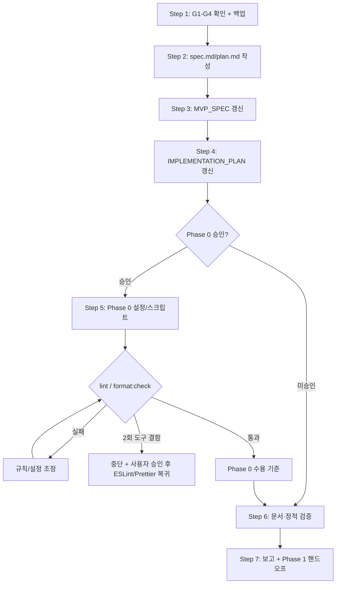

# Plan: rclone 기반 폴더 비교·동기화 데스크톱 앱 (rcloneGUI) — oxlint·oxfmt 전환

- Intent: [INT-001](intent.md) | Tier: 2 | 작성일: 2026-10-28

> 이 plan은 [`spec.md`](spec.md)의 delta 명세를 문서와 Phase 0 구현으로 옮기는 실행 계획이다.
> 전체 앱 구현 순서는 [`IMPLEMENTATION_PLAN.md`](../../../specs/IMPLEMENTATION_PLAN.md)를 따른다.

## 1. Tier 산정

### 1.1 결과: **Tier 2 (Minor)**

| 판단 축 | 내용 |
| :--- | :--- |
| 변경 범위 | 설계 문서 2건 수정 + delta spec/plan 2건 신규 + Phase 0에서 설정 2건/패키지 2건 |
| 코드 영향 | 현재 소스 코드 0건. 런타임 로직/IPC/데이터 모델 변경 없음 |
| 파괴적 변경 | 없음. 파일 삭제/DB 마이그레이션/런타임 동작 변경 없음 |
| 복구 | `docs/specs` 백업, 설정 파일 삭제, lockfile 재설치로 즉시 복구 가능 |
| 검증 | 문서 검증 + Phase 0에서 `lint`/`format:check`/`build`/`dev` |
| 상위 intent | INT-001 자체는 Tier 3이지만, 이 delta는 개발 도구 체인에 한정되므로 Tier 2 |

**에스컬레이션**: Phase 0에서 oxlint/oxfmt 전환이 빌드·개발 서버·preload 로딩을 깨고,
설정 조정으로 해결되지 않으면 Tier 3으로 상향하고 `code-planner` → `code-implementer` →
`code-tester` 전체 파이프라인과 Windows 수용 테스트를 적용한다.

### 1.2 변경 파일 수

| 구분 | 경로 | 수 |
| :--- | :--- | :--- |
| 문서 신규 | `docs/intent/planned/INT-001-rclone-sync-gui/spec.md`, `plan.md` | 2 |
| 문서 수정 | `docs/specs/MVP_SPEC.md`, `docs/specs/IMPLEMENTATION_PLAN.md` | 2 |
| 백업 | `docs/specs/*.bak_20261028-140418` | 2 |
| 설정 신규(Phase 0) | `.oxlintrc.json`, `.oxfmtrc.json` | 2 |
| 패키지(Phase 0) | `package.json`, `package-lock.json` | 2 |

현재 단계(문서)의 변경은 6개 경로(신규 2 + 수정 2 + 백업 2)이며, 소스 코드는 포함하지 않는다.

## 2. 실행 순서 (Steps)

### Step 1 — Preflight·게이트 확인·백업

- **목표**: G1~G4 결과를 확인하고, 기존 `docs/specs` 문서를 백업한다.
- **변경 대상**: `docs/specs/MVP_SPEC.md.bak_20261028-140418`,
  `docs/specs/IMPLEMENTATION_PLAN.md.bak_20261028-140418`
- **선행 의존**: 없음
- **검증 방법**:
  - `ls docs/specs/*.bak_20261028-140418`로 2건 확인.
  - 백업의 크기/줄 수가 수정 전 기록(90,436 B/1,806줄, 36,571 B/805줄)과 일치하는지 확인.
  - `intent.md`의 `status: planned`와 `id: INT-001` 확인.
- **롤백 방법**: 백업 파일만 삭제한다(아직 원본 변경 없음).
- **게이트 로그**:
  - G1: 메시지에 intent 경로가 직접 없어, 첨부된 `MVP_SPEC.md` 4행의
    `연결 Intent: docs/intent/planned/INT-001-rclone-sync-gui/intent.md` 링크로 경로를 해석.
  - G2: `docs/intent/planned/INT-001-rclone-sync-gui/intent.md` 존재, frontmatter `id: INT-001` 확인.
  - G3: intent 폴더에 기존 `spec.md`/`plan.md` 없음. 덮어쓰기 확인 불필요.
  - G4: `status: planned`로 `done`이 아님. 재작업 경고 불필요.

### Step 2 — `spec.md`/`plan.md` 작성

- **목표**: 이번 delta의 요구사항/인터페이스/수용 기준과 실행 계획을 intent 폴더에 만든다.
- **변경 대상**: `docs/intent/planned/INT-001-rclone-sync-gui/spec.md`,
  `docs/intent/planned/INT-001-rclone-sync-gui/plan.md`
- **선행 의존**: Step 1
- **검증 방법**:
  - spec.md 목차 §1~§10, plan.md 목차 §1~§6 확인.
  - spec.md의 JSON 코드 블록을 `python3 -m json.tool`로 파싱.
  - plan.md 매핑 표에 모든 Step이 포함되고 intent T-NN과 일치하는지 대조.
  - 상대 링크(`intent.md`, `../../../specs/MVP_SPEC.md`, `../../../specs/IMPLEMENTATION_PLAN.md`) 확인.
- **롤백 방법**: 신규 `spec.md`/`plan.md` 삭제.

### Step 3 — `MVP_SPEC.md` 갱신

- **목표**: 설계 SSOT에서 ESLint/Prettier 전제를 제거하고 oxlint/oxfmt로 교체한다.
- **변경 대상**: `docs/specs/MVP_SPEC.md`
  - §0 핵심 결정 표: 린트/포맷 행 추가
  - §1.2 Tier 3 완료 조건: `format:check` 추가
  - §2.1 item 10: 스크립트 목록 갱신
  - §4.3 디렉터리 트리: `eslint.config.mjs` → `.oxlintrc.json`, `.oxfmtrc.json`
  - §4.4 버전 표: ESLint/TS-ESLint/Hooks/Prettier 행 제거, oxlint/oxfmt 행 추가
  - §4.4 주의: TS 5.9.3 근거, type-aware 미사용, native binding, `printWidth`/정렬 주의
  - §17.1 scripts: oxlint/oxfmt 명령으로 교체
  - §17.3 문서: README/AGENTS 기록 항목 추가
  - §19 리스크: R9 문구 수정, R10 보강, R17/R18 추가
  - §20 가정: TypeScript 7/type-aware 결정 추가
  - 부록 A: oxlint/oxfmt 버전·호환성 근거 추가
- **선행 의존**: Step 2
- **검증 방법**:
  - `grep -n "eslint.config.mjs\|.prettierrc\|prettier --write\|eslint . --max-warnings=0" docs/specs/MVP_SPEC.md`로
    활성 참조 0건 확인(역사적/롤백/마이그레이션 문맥 제외).
  - `oxlint 1.90.0`/`oxfmt 0.75.0` 문자열과 `format:check`가 Tier 3/§17.1에 존재하는지 확인.
  - 마크다운 표/헤딩 구조 확인.
- **롤백 방법**: `cp docs/specs/MVP_SPEC.md.bak_20261028-140418 docs/specs/MVP_SPEC.md`

### Step 4 — `IMPLEMENTATION_PLAN.md` 갱신

- **목표**: 구현 계획의 Phase 0/테스트/DoD/릴리스 체크리스트를 새 도구 체인에 맞춘다.
- **변경 대상**: `docs/specs/IMPLEMENTATION_PLAN.md`
  - §1.2 Windows 명령: `format:check` 추가, native binding/WSL 주의
  - §1.3 버전 고정: TS 5.9.3 근거 수정, oxlint/oxfmt 정확한 버전 고정
  - Phase 0 파일/작업/검증/합격 기준: 설정 2건, devDeps, `format:check`, 버전 확인
  - §4.1 테스트 계층: Static에 oxlint, Format 계층 추가
  - §4.2 Phase 0 최소 테스트: `format:check` 추가
  - §4.3 실행 명령: `format:check` 추가
  - §4.4 공통 합격 기준: `format:check` 추가
  - §6 Phase 0 체크포인트: oxlint/oxfmt 추가
  - §8 릴리스 체크리스트: `format:check`/버전/잔재 확인
  - §9 구현 순서 요약: Phase 0에 도구 기준선 추가
- **선행 의존**: Step 3
- **검증 방법**:
  - `grep -n "ESLint\|Prettier\|eslint.config.mjs\|typescript-eslint" docs/specs/IMPLEMENTATION_PLAN.md`로
    활성 참조 0건 확인(역사적/롤백 문맥 제외).
  - Phase 0 명령에 `npm.cmd run lint`/`format:check`가 모두 있는지 확인.
  - §4.1/§4.2/§4.3/§4.4/§6/§8/§9의 상호 참조 일관성 확인.
- **롤백 방법**: `cp docs/specs/IMPLEMENTATION_PLAN.md.bak_20261028-140418 docs/specs/IMPLEMENTATION_PLAN.md`

### Step 5 — Phase 0 구현(승인 후): 설정·스크립트 추가

- **목표**: 실제 스캐폴드에 `.oxlintrc.json`/`.oxfmtrc.json`과 scripts/devDeps를 적용한다.
- **변경 대상**:
  - `.oxlintrc.json` (spec §6.4)
  - `.oxfmtrc.json` (spec §6.5)
  - `package.json` (spec §6.2/§6.3)
  - `package-lock.json` (`npm.cmd install` 결과)
- **선행 의존**: Step 3, Step 4, Phase 0 스캐폴드 생성
- **검증 방법**:
  - `npm.cmd install`
  - `npm.cmd exec -- oxlint --version` → `1.90.0`
  - `npm.cmd exec -- oxfmt --version` → `0.75.0`
  - `npm.cmd exec -- oxlint --print-config`로 설정 로드 확인
  - `npm.cmd run lint`, `npm.cmd run format:check`
- **롤백 방법**: 설정 2건 삭제, `package.json`/lockfile에서 oxlint/oxfmt 제거 후 `npm.cmd install`.
  ESLint/Prettier 복귀는 사용자 승인 후에만 수행한다.

### Step 6 — 문서·정적 검증

- **목표**: 문서/설정 명세가 일관되고 LF/CR·BOM·잔재·매핑이 모두 통과하는지 확인한다.
- **변경 대상**: 없음(읽기 전용 검증)
- **선행 의존**: Step 2~5
- **검증 방법**:
  - Python으로 신규/수정 파일의 `CR` 0, BOM 없음 확인.
  - spec.md의 JSON 블록 파싱.
  - 활성 ESLint/Prettier 참조 grep(`*.bak_*` 제외).
  - `git status --short --untracked-files=all`로 변경 범위 확인(기존 untracked 파일 포함).
  - `intent.md`의 본문/status/priority/tasks가 편집되지 않았는지 확인.
- **롤백 방법**: 실패 시 Step 3/4 백업 복원 또는 Step 2 신규 파일 수정.

### Step 7 — 최종 보고·핸드오프

- **목표**: 산출물/백업/미해결 질문/다음 단계를 스킬 보고 형식으로 정리한다.
- **변경 대상**: 없음(보고만)
- **선행 의존**: Step 6
- **검증 방법**: 보고에 G1~G4, 산출물 수, 백업, intent 미변경, 미해결 질문, 다음 단계 포함.
- **롤백 방법**: 해당 없음.

## 3. Intent 태스크 매핑

| Plan Step | Intent T-NN | 매핑 근거 |
| :--- | :--- | :--- |
| Step 1 — Preflight/백업 | T-01, T-15 | Phase 0 준비, 문서 보존 |
| Step 2 — spec/plan 작성 | T-01, T-15 | 구현 전 설계, 문서 산출 |
| Step 3 — MVP_SPEC 갱신 | T-01, T-12, T-15 | 스캐폴딩 기준, 테스트/패키징 기준, 문서 |
| Step 4 — IMPLEMENTATION_PLAN 갱신 | T-01, T-12, T-15 | Phase 0/검증/문서 계획 |
| Step 5 — 설정·스크립트 구현 | T-01 | Phase 0 스캐폴딩 |
| Step 6 — 문서·정적 검증 | T-01, T-12 | 스캐폴딩/테스트 기준 검증 |
| Step 7 — 최종 보고 | T-15 | 문서/수용 보고 |

intent.md의 T-01/T-12/T-15 문구는 수정하지 않는다. 이 표는 매핑만 제공한다.

## 4. 검증 계획 (DoD)

### 4.1 이번 delta(Tier 2)의 DoD

- [ ] `spec.md`가 §1~§10, `plan.md`가 §1~§6 목차를 갖춘다.
- [ ] spec.md의 모든 JSON 코드 블록이 유효한 JSON이다.
- [ ] `docs/specs`에서 활성 ESLint/Prettier 참조가 0건이다(역사적/롤백 문맥 제외).
- [ ] `format:check`가 MVP_SPEC Tier 3, IMPLEMENTATION_PLAN Phase 0/§4/§8에 포함된다.
- [ ] `oxlint 1.90.0`/`oxfmt 0.75.0` 정확한 버전이 문서에 명시된다.
- [ ] `docs/specs/*.bak_20261028-140418` 2건이 존재하고 수정 전 크기/줄 수와 일치한다.
- [ ] 신규/수정 파일의 CR 0, BOM 없음.
- [ ] 이번 작업의 변경이 `docs/intent/.../spec.md`, `plan.md`, `docs/specs/*.md`, `docs/specs/*.bak_*`에 한정된다
  (기존 untracked `.gitignore`/`docs/` 파일 제외).
- [ ] `intent.md`가 변경되지 않았다.

### 4.2 Phase 0/전체 INT-001(Tier 3)의 DoD

- [ ] `npm.cmd install` 성공, `oxlint`/`oxfmt` Windows native binding 정상.
- [ ] `npm.cmd run typecheck` exit 0.
- [ ] `npm.cmd run lint` (`oxlint --deny-warnings`) exit 0.
- [ ] `npm.cmd run format:check` (`oxfmt --check`) exit 0.
- [ ] `npm.cmd run build`/`npm.cmd run dev` 성공, 렌더러 콘솔 에러 0건.
- [ ] `oxlint --version` = `1.90.0`, `oxfmt --version` = `0.75.0`.
- [ ] `package.json`에 ESLint/Prettier/TS-ESLint 의존성 0건.
- [ ] `docs/**`, `tests/fixtures/**`가 포맷/lint 대상에서 제외됨.
- [ ] 전체 단위/통합/E2E/NSIS 빌드 및 실제 환경 수용은 부모 INT-001 Tier 3 DoD를 따른다.

### 4.3 검증 명령(Windows PowerShell)

```powershell
cd D:\dev-Joy\rcloneGUI
npm.cmd install
npm.cmd run typecheck
npm.cmd run lint
npm.cmd run format:check
npm.cmd run build
npm.cmd exec -- oxlint --version
npm.cmd exec -- oxfmt --version
```

WSL에서 Windows 도구를 호출할 때만:

```bash
cmd.exe /c "cd /d D:\dev-Joy\rcloneGUI && npm.cmd run lint"
cmd.exe /c "cd /d D:\dev-Joy\rcloneGUI && npm.cmd run format:check"
```

### 4.4 롤백 기준

- 도구 결함(설정으로 해결 불가)이 **2회 연속** 발생하면 중단하고 사용자에게 보고한다.
- 사용자 승인 후 ESLint/Prettier 체제로 복귀한다. 자동 회귀하지 않는다.
- 백업 복원 후 `npm.cmd install`로 lockfile을 재생성하고, `typecheck`/`test`를 다시 실행한다.

## 5. 리스크 · 파급

### 5.1 브레이킹 체인지/데이터

| 항목 | 판정 |
| :--- | :--- |
| 런타임 브레이킹 체인지 | 없음. 개발 도구만 변경 |
| API/IPC/데이터 모델 변경 | 없음 |
| 데이터 마이그레이션 | 없음 |
| 사용자 데이터 접근 | 없음(문서/Phase 0 스캐폴드만) |
| 패키지 산출물 영향 | 없음. oxlint/oxfmt는 devDependencies |

### 5.2 리스크와 완화

| # | 리스크 | 완화 | 롤백 |
| :--- | :--- | :--- | :--- |
| P-R1 | oxlint 규칙 공백 | `tsc` 유지, 핵심 규칙 명시 | 규칙 추가/조정 |
| P-R2 | 경고 폭증으로 `--deny-warnings` 실패 | Phase 0 baseline, severity/override 조정 | 규칙 완화 |
| P-R3 | oxfmt 0.x 변경 | 정확한 버전 고정, diff 리뷰 | 이전 버전 고정 |
| P-R4 | native binding 실패 | `npm.cmd install` 재시도, lockfile 재설치 | 사용자 승인 후 ESLint/Prettier |
| P-R5 | React Hooks/Fast Refresh 오탐 | warn 유지, 파일별 disable+사유 | 규칙 severity 조정 |
| P-R6 | docs/fixtures 재포맷 | ignorePatterns, `format:check` | 백업 복원 |
| P-R7 | 문서-구현 불일치 | 이 spec/plan + Phase 0 DoD + grep | 문서 재동기화 |
| P-R8 | TS 7/type-aware 조기 도입 | MVP 미사용, 별도 승인 | 설정에서 제외 유지 |

### 5.3 파급

- Phase 0부터 모든 Phase의 종료 검증에 `format:check`가 추가된다.
- 릴리스 체크리스트와 README/AGENTS의 명령이 바뀐다.
- CI가 없으므로 파이프라인 변경은 없다. CI 도입 시 `lint`/`format:check`를 추가한다.

## 6. 실행 흐름


