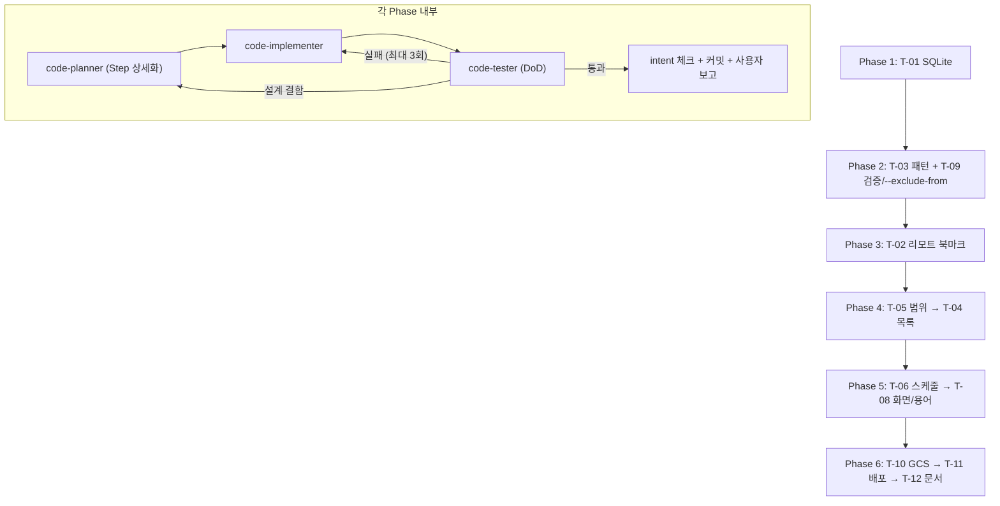

# Plan: rcloneGUI 스케줄·SQLite·리모트/제외 패턴 UX 개선

- Intent: [INT-002](intent.md) | Tier: 3 | 작성일: 2026-10-29

> 이 plan은 [`spec.md`](spec.md)를 Phase 단위 실행 계획으로 나눈 것이다. Phase 순서는 intent의 "진행 순서"를 따른다.
> Phase마다 code-planner → code-implementer → code-tester 파이프라인을 다시 돌린다. 이 문서의 Step은 그 입력이다.

## 1. Tier 산정

### 1.1 결과: **Tier 3 (Major)**

| 판단 축 | 내용 |
| :--- | :--- |
| 변경 범위 | 저장 계층 전면 교체, 스키마·IPC·명령 빌더·계획 토큰·스케줄·화면 10여 개. 파일 60개 이상 |
| 파괴적 변경 | JSON → SQLite 데이터 이전(`.migrated` rename). 구버전으로 되돌리면 빈 목록. 전역 패턴이 sync 삭제 범위에 영향을 줌 |
| 안전 규칙 | 규칙 1~6은 바꾸지 않음. `ALLOWED_COMMANDS`도 늘리지 않음 |
| 복구 | JSON `.migrated` → 원래 이름, `db-backups\`, 커밋 단위 revert |
| 검증 | check · format:check · test:int · test:e2e · build:win · smoke:installer, T-10은 GCS(키가 없으면 skip) |

Phase별 Tier: P1 3, P2 3, P3 2, P4 3, P5 3, P6 2.

## 2. 실행 순서 (Steps)

모든 Step의 공통 검증은 `pnpm run check`와 `pnpm run format:check`(Windows PowerShell)다. 아래 "검증"에는 그 밖의 추가 검증만 적었다. 공통 롤백은 그 Step의 커밋을 `git revert`하는 것이다.

### Phase 1 — T-01 SQLite (단독) — **구현 완료, 검증 중**
| Step | 목표 | 변경 대상 | 선행 | 검증 | 롤백 |
| :--- | :--- | :--- | :--- | :--- | :--- |
| 1.1 | 어댑터와 probe(vitest, external, VACUUM INTO) | `src/main/store/sqlite-db.ts`, `tests/unit/sqlite-db.test.ts`, `shared-boundary.test.ts` | — | unit, `out/main/index.js`의 `require("node:sqlite")` | 파일 삭제 |
| 1.2 | 스키마 v1과 마이그레이션 체계 | `db-schema.ts` + 테스트 | 1.1 | unit | 〃 |
| 1.3 | store 3종을 DB로 교체(API 유지), 이력 offset | `job/settings/history-store.ts`, `json-store.ts`(`renameWithRetry`), `schemas/history.ts` | 1.2 | unit `stores.test.ts` | revert |
| 1.4 | JSON 이전, 손상 복구, 백업 | `json-import.ts`, `app-db.ts`, fixture `tests/fixtures/store-v1/` | 1.3 | unit | revert |
| 1.5 | 시작 순서 연결 | `src/main/index.ts`, `run-harness.ts`, `drive-app.mjs` | 1.4 | test:int, E2E `migration.spec.ts`, build:win, smoke:installer | revert. 사용자 데이터는 `.migrated`를 원래 이름으로 |
| 1.6 | 문서 | README §4, MVP_SPEC §5.6, CHANGELOG, works | 1.5 | 문서 확인 | revert |

### Phase 2 — T-03 제외 패턴 + T-09 길이·`--exclude-from`
| Step | 목표 | 변경 대상 | 선행 | 검증 | 롤백 |
| :--- | :--- | :--- | :--- | :--- | :--- |
| 2.1 | **probe 먼저:** `#`·`;` 주석, 인자 방식과 `--exclude-from` 결과가 같은지, BOM·CRLF 처리 | `scripts/probes/rclone-probes.mjs`, `tests/fixtures/rclone/`, `docs/knowhow/rclone-notes.md` | P1 | probe 결과 기록 | fixture 삭제 |
| 2.2 | 길이 한도 상수와 zod(로드 4096 / 저장 1024, spec Q1 결정 후) | `src/shared/schemas/job.ts`·`settings.ts`, 새 파일 `src/shared/option-limits.ts` | — | unit `schemas.test.ts` | revert |
| 2.3 | 스키마 v2: `job_exclude_patterns`, 패턴 CHECK에 `#`·`;` 차단, 기존 `#`·`;` 패턴 검사 | `db-schema.ts`, `app-db.ts` | P1 | unit `db-schema.test.ts`(v1→v2, pre-v2 백업) | `db-backups\pre-v2-*` |
| 2.4 | 패턴 저장소와 IPC `excludes:*`(사용 작업, CONFIRM_REQUIRED, 캐시 무효화) | 새 파일 `src/main/store/exclude-store.ts`, `src/main/ipc/excludes.ts`, `ipc-contract.ts`, `preload` | 2.3 | unit, IPC envelope 테스트 | revert |
| 2.5 | 실제로 쓰는 패턴 합치기, `--exclude-from` 임시 파일(`wx`·LF·BOM 없음·실행 후 삭제·시작 시 정리), 명령 길이 검사 | `command-builder.ts`(`f_PushCommon`), `run-service.ts`, `compare-service.ts`, 새 파일 `src/main/services/exclude-file.ts` | 2.1, 2.4 | unit `command-builder.test.ts`(차단 목록 그대로), test:int | revert |
| 2.6 | 계획 토큰에 패턴 스냅샷 해시 | `plan-token.ts` + 테스트 | 2.5 | unit `plan-token.test.ts`, test:int `run.gates` | revert |
| 2.7 | 화면: 라이브러리 체크박스, 새 패턴, 한 줄 입력 유지, 수정·삭제 확인 모달(자동 작업 강조), 필드별 길이 오류, "rclone.conf 값 사용" 표시 | `ExcludesEditor.tsx`, `JobEditor.tsx`, `JobOptionsFields.tsx`, `SettingsPage.tsx`, 새 store `src/stores/excludes-store.ts` | 2.4 | unit `job-form.test.ts`, test:e2e | revert |

### Phase 3 — T-02 리모트 북마크·폴더 탐색
| Step | 목표 | 변경 대상 | 선행 | 검증 | 롤백 |
| :--- | :--- | :--- | :--- | :--- | :--- |
| 3.1 | `listremotes --long` 파서, 폴더 목록 인자(`lsjson --max-depth 1 --dirs-only --ask-password=false`) | `command-builder.ts`, `src/main/parsers/`, `rclone/config.ts` | P2 | unit(실제 출력 fixture), `ALLOWED_COMMANDS` 그대로 | revert |
| 3.2 | 북마크 store(`remotes` 테이블)와 IPC `remotes:*`, `rclone:listDir`, 직렬 큐(탐색·테스트 1개, 실행 중 같은 remote는 BUSY) | 새 파일 `src/main/store/remote-store.ts`, `src/main/ipc/remotes.ts`, `activity-lock.ts` 연동 | 3.1 | unit, test:int(local remote alias) | revert |
| 3.3 | 화면: 설정의 리모트 관리, 경로 필드의 북마크 선택과 폴더 탐색 모달 | `RemotePicker.tsx`, `PathField.tsx`, `SettingsPage.tsx`, 새 컴포넌트 `src/pages/RemoteBrowser.tsx`, `src/stores/remotes-store.ts` | 3.2 | test:e2e(임시 conf의 local remote) | revert |

### Phase 4 — T-05 동기화 범위 → T-04 작업 목록
| Step | 목표 | 변경 대상 | 선행 | 검증 | 롤백 |
| :--- | :--- | :--- | :--- | :--- | :--- |
| 4.1 | **probe:** `--create-empty-src-dirs` copy/sync, 대상 빈 폴더 삭제가 dry-run 출력과 `--max-delete`에 잡히는지, GCS 동작은 T-10에서 | `rclone-probes.mjs`, fixtures, rclone-notes | P1 | 기록 | — |
| 4.2 | `scope` 스키마(기본 `files`), 비교 목록에 폴더 포함, diff에 폴더 상태(spec Q4) | `schemas/job.ts`, `command-builder.ts`(`buildLsjsonArgs`), `lsjson-parser.ts`, `diff-engine.ts` | 4.1 | unit `diff-engine`·`lsjson-line-parser` | revert |
| 4.3 | 실행·미리보기·삭제 수·`autoMaxDeletes`·계획 토큰에 범위 적용 | `buildTransferArgs`, `run-plan.ts`, `run-gates.ts`(로직은 그대로, 입력만), `plan-token.ts` | 4.2 | unit, test:int(빈 폴더 시나리오) | revert |
| 4.4 | 편집기 범위 선택 UI | `JobEditor.tsx`/`JobOptionsFields.tsx` | 4.3 | unit `job-form` | revert |
| 4.5 | 작업 목록 확장(원본·대상·자동·스케줄 요약·최근 동기화·상태 텍스트), 설정 `ui.showJobStatusText` | `JobSidebar.tsx`·`.module.css`, `schemas/settings.ts`, `SettingsPage.tsx`, `src/lib/path-display.ts` | 4.4 | unit, test:e2e | revert |
| 4.6 | 목록에서 실행: 기존 `JobWorkspace`의 비교 → 확인 → `run.start` 흐름을 공용 훅으로 뽑아 재사용(spec Q7) | 새 파일 `src/lib/use-run-flow.ts`, `JobSidebar.tsx`, `JobWorkspace.tsx` | 4.5 | test:e2e(삭제 있는 sync가 모달을 거침) | revert |

### Phase 5 — T-06 앱 스케줄러 → T-08 화면 재구성
| Step | 목표 | 변경 대상 | 선행 | 검증 | 롤백 |
| :--- | :--- | :--- | :--- | :--- | :--- |
| 5.1 | 스케줄 모델(interval/daily/weekly), 로컬 시간 계산, DST | `src/shared/schedule.ts`, `schemas/job.ts`, (spec Q8) 스키마 v3 `schedules` 이전 | P4 | unit `schedule.test.ts`(TZ 고정), `db-schema` | `db-backups\pre-v3-*` |
| 5.2 | 스케줄러가 새 모델을 쓰게 함(게이트·`startAuto` 그대로) | `scheduler.ts` | 5.1 | unit `scheduler.test.ts`, test:int `auto-run` | revert |
| 5.3 | 트레이 종료 경고(다음 예약 표시), 로그인 시 시작 꺼짐 안내 | `src/main/index.ts`(`f_RequestQuit`), `tray.ts`, `JobEditor.tsx` | 5.2 | drive-app, test:e2e | revert |
| 5.4 | `/mnt/x` 변환 확인 테스트 | `tests/unit/path-utils.test.ts` | — | unit | — |
| 5.5 | 스케줄 편집 UI | `JobEditor.tsx` | 5.1 | test:e2e | revert |
| 5.6 | 화면 재구성(비교·미리보기 → 실행 → 결과·이력), 공통 중지 컨트롤 | `JobWorkspace.tsx`, `RunView.tsx`, `CompareView.tsx`, `CompareToolbar.tsx` | 5.5 | test:e2e 셀렉터 갱신, 콘솔 오류 0 | revert |
| 5.7 | 용어 전수 검토(문구 목록 → 수정), sync 오류 무시 시 백업 폴더 안내 | `src/pages/**`, `src/lib/*-view.ts` | 5.6 | unit `*-view.test.ts`, test:e2e | revert |

### Phase 6 — T-10 GCS 수용 → T-11 배포 → T-12 문서
| Step | 목표 | 변경 대상 | 선행 | 검증 | 롤백 |
| :--- | :--- | :--- | :--- | :--- | :--- |
| 6.1 | GCS 수용 테스트(환경 변수 conf, `rclonegui-test-` 접두사 검사, 고유 하위 경로·정리, copy/sync/삭제/취소, `전체` 범위 빈 폴더) | 새 파일 `tests/integration/gcs-acceptance.test.ts`, rclone-notes, CHANGELOG | P5 | `test:int`(키가 없으면 skip하고 이유 출력) | 파일 삭제 |
| 6.2 | 배포 형태 확인(NSIS 하나, portable 없음) | `electron-builder.yml` 확인, README | P5 | build:win, smoke:installer | — |
| 6.3 | 문서 갱신 | README, AGENTS(구조·명령), MVP_SPEC, CHANGELOG | 6.2 | 문서 확인 | revert |

## 3. Intent 태스크 매핑

| intent 태스크 | plan Step | 비고 |
| :--- | :--- | :--- |
| T-01 SQLite | 1.1~1.6 | Phase 1 |
| T-02 리모트 북마크 | 3.1~3.3 | Phase 3 |
| T-03 제외 패턴 | 2.3, 2.4, 2.6, 2.7 | Phase 2 |
| T-04 작업 목록 | 4.5, 4.6 | Phase 4 |
| T-05 동기화 범위 | 4.1~4.4 | Phase 4. 폴더만은 P3 |
| T-06 앱 스케줄러 | 5.1~5.5 | Phase 5 |
| T-07 (P3 보류) | — | 범위 밖. 5.7에서 백업 폴더 안내만 |
| T-08 화면 재구성 | 5.6, 5.7 | Phase 5 |
| T-09 옵션 검증 | 2.1, 2.2, 2.5, 2.7 | Phase 2 |
| T-10 GCS 수용 | 6.1 | Phase 6 |
| T-11 배포 형태 | 6.2 | Phase 6 |
| T-12 문서 | 1.6, 6.3, 각 Phase의 CHANGELOG | |
| T-13 (P3 보류) | — | 범위 밖 |

## 4. 검증 계획 (DoD)

**Phase 공통 (Tier 3):**
- [ ] `pnpm run check` (typecheck + oxlint + eslint + unit)
- [ ] `pnpm run format:check`
- [ ] 빌더·파서·안전 로직을 바꿨다면: 테스트를 추가하고 `pnpm run test:int`
- [ ] 화면·패키징을 바꿨다면: `pnpm run test:e2e`(콘솔 오류 0), `pnpm run build:win`
- [ ] 저장·시작 순서를 바꿨다면: `pnpm run smoke:installer`, `node scripts/dev/drive-app.mjs`(임시 userData)
- [ ] CHANGELOG 한 줄, rclone-notes(새 rclone 동작), `docs/works/` 기록
- [ ] intent 태스크 체크(intent-manager), Phase 커밋(`z_skill_git_commit`)

**Phase별 추가:**
- **P1:** AC-1~4. 어댑터 경계 테스트
- **P2:** AC-5~7. probe 기록. 차단 목록 테스트 그대로 통과
- **P3:** AC-8. `ALLOWED_COMMANDS` 변경 없음
- **P4:** AC-9~11
- **P5:** AC-12~13
- **P6:** AC-14~16

## 5. 리스크 · 파급

| 구분 | 내용 | 롤백 기준 |
| :--- | :--- | :--- |
| 데이터 마이그레이션 | P1 JSON → SQLite. P2 v2, P5 v3 스키마 변경 | 시작 실패나 데이터 누락이 보이면 커밋을 revert하고 사용자 데이터는 `.migrated`·`db-backups\`에서 복원. 실제 userData 백업: `%APPDATA%\rcloneGUI-backup-before-INT002-20261029-195422` |
| 브레이킹 체인지 | 구버전으로 되돌리면 빈 목록(문서화). IPC `history.list` offset은 하위 호환 | — |
| 삭제 범위 | 전역 패턴(P2)·범위(P4)가 sync 삭제 대상에 영향 | 계획 토큰 테스트나 probe가 맞지 않으면 해당 Step을 중단하고 code-planner로 되돌림 |
| 안전 규칙 | 바꾸지 않음. 바꿔야 할 상황이 생기면 즉시 중단하고 사용자 승인 요청 | — |
| 화면 회귀 | P4·P5 재구성으로 E2E 셀렉터가 바뀜 | 같은 Step에서 E2E를 갱신하고 통과시킨 뒤 커밋 |
| 외부 의존 | T-10 GCS 키 | 없으면 skip하고 사유를 보고(DoD 예외) |

## 6. 실행 흐름

