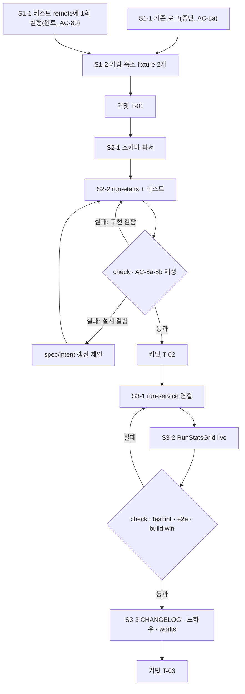

# Plan: 작은 파일이 많은 실행에서도 믿을 수 있는 남은 시간 표시

- Intent: [INT-004](intent.md) | Tier: 2 | 작성일: 2026-11-03

> spec: [spec.md](spec.md). 진행 순서는 intent를 따른다: T-01 → T-02 → T-03.
> Phase마다 검증을 통과하면 커밋한다(한 커밋에 한 가지 변경).

## 1. Tier 산정

**Tier 2 (Minor)**

- 범위: 파서 1개, shared 스키마 1개, 신규 순수 모듈 1개, run-service의 stats 처리부, 화면 컴포넌트 2개(`RunStatsGrid`, `RunView`), 테스트 2개, fixture 2개. 10개 안팎 파일.
- 안전 로직 변경: 없음. 명령 인자·게이트·전송 시작 조건은 그대로다(spec AC-12).
- 파괴적 변경: 없음. 이력 스키마에 기본값 있는 필드 두 개만 추가하므로 마이그레이션이 없다. `etaSeconds`의 의미가 바뀌지만, 끝난 실행 화면은 "-"만 보여 사용자에게 드러나지 않는다.
- 다만 화면을 바꾸므로 프로젝트 완료 기준(AGENTS 6장)에 따라 E2E와 `build:win`까지 확인한다.

## 2. 실행 순서 (Steps)

### Phase 1 — T-01 Drive stats fixture 확보 (spec §10 Q-1: 2026-11-03 로그는 중단된 실행)

**S1-1 원본 로그 확보**
- 목표: 원본 로그 두 개를 얻는다.
  - 중단된 실행(AC-8a 안정성용): 2026-11-03 실행 로그(`%APPDATA%\rcloneGUI\logs`, 11:09 시작, 1,815개 중 667개에서 중단)를 쓴다.
  - 완료한 실행(AC-8b 정확도용): `RCLONEGUI_TEST_DRIVE_REMOTE`로 지정한 테스트 remote의 `rclonegui-test-it/rclonegui-it-<시각>-<난수>/` 아래로 작은 파일 200개와 30MB 파일 하나를 올리는 실행을 한 번 하고, 끝나면 그 폴더만 지운다(AGENTS 4.8 예외 규칙). 15분 안팎 걸린다.
- 변경: 없음(원본은 저장소 밖에 둔다).
- 선행: 없음.
- 검증: 완료한 실행은 마지막 stats에서 `transfers == totalTransfers`이고 종료 코드가 0이다.
- 롤백: 해당 없음.

**S1-2 가림·축소해서 fixture로 저장**
- 목표: 중단된 실행은 `tests/fixtures/rclone/drive-small-files-progress-partial.stderr.txt`, 완료한 실행은 `tests/fixtures/rclone/drive-small-files-progress.stderr.txt`로 만든다.
- 변경: fixture 파일 2개. 가림은 커밋하지 않는 일회성 node 명령으로 한다(실험용 코드 커밋 금지).
  - stats 줄만 남긴다.
  - `msg`는 빈 문자열로 바꾼다(파일 이름이 들어 있음).
  - `transferring[]`의 `name`은 `file-<n>`, `srcFs`·`dstFs`는 `<SRC>`·`<DST>`로 바꾼다.
  - 다른 필드와 값은 그대로 둔다(원본 보존 원칙, `.gitattributes`의 fixtures 예외).
  - 파일이 500KB를 넘으면 5초 간격 줄만 남기고, 처음 30초와 마지막 줄은 모두 남긴다.
- 선행: S1-1.
- 검증: `grep`으로 remote 이름·사용자 경로·원래 파일 이름이 0건임을 확인한다. `pnpm run format:check`는 fixture를 다루지 않으므로 생략한다.
- 롤백: fixture 파일 삭제.
- 커밋: `test: Google Drive 실행 stats fixture 추가 (INT-004 T-01)`

### Phase 2 — T-02 계산 순수 함수 (선행: Phase 1. fixture 재생 테스트만 Phase 1에 의존)

**S2-1 스키마·파서**
- 목표: `zRunStats`에 `partialFiles`·`etaPending`을 추가하고, `zRawStats`에 `transferring`을 추가하고, `normalizeStats`가 `partialFiles`를 내게 한다(spec FR-1, §6.1).
- 변경: `src/shared/schemas/run.ts`, `src/main/parsers/log-parser.ts`, `tests/unit/rclone-parsers.test.ts`, 필요하면 `tests/unit/schemas.test.ts`(예전 이력 파싱, AC-10).
- 선행: 없음.
- 검증: `pnpm run check`, `pnpm run format:check`. `typRunStats`를 만드는 다른 곳(테스트 도우미 `tests/unit/fixtures.ts`, run-service 초기값 등)이 타입 오류 없이 통과해야 한다.
- 롤백: 세 파일을 되돌린다.

**S2-2 `run-eta.ts`**
- 목표: `etaTotals`·`rawEtaSeconds`·`nextEta`를 구현한다(spec FR-2~FR-8, §6.2).
- 변경: `src/main/services/run-eta.ts`(신규, `docs/guide/File.tsx.guide` 구조), `tests/unit/run-eta.test.ts`(신규).
- 선행: S2-1.
- 검증: AC-2~AC-7, AC-11, AC-13 단위 테스트를 작성하고, AC-8a·AC-8b는 Phase 1 fixture를 `parseLogLine`으로 재생해 확인한다. `pnpm run check`, `pnpm run format:check`. AC-8 범위를 넘으면 범위를 바꾸지 말고 원인(분모·부분 진행률·평활)을 진단한다. 범위는 spec AC-8 허용 범위 고정 규칙에 따라 넓히는 방향만, 사유를 spec §10에 남긴 뒤에만 바꾼다.
- 롤백: 신규 두 파일을 삭제한다.
- 커밋: `feat: 파일 수를 반영한 남은 시간 계산 함수 추가 (INT-004 T-02)`(S2-1 포함)

### Phase 3 — T-03 실행 경로·화면 연결 (선행: Phase 2)

**S3-1 run-service 연결**
- 목표: 단계마다 계산 상태를 초기화하고(FR-9), `onLine`에서 stats마다 `nextEta`로 `etaSeconds`·`etaPending`을 채워 snapshot·batcher에 넣는다(FR-11).
- 변경: `src/main/services/run-service.ts`(`itfActiveRun`에 계산 상태 한 필드, `spawnTransfer` 시작부, `onLine`), `tests/unit/run-service.test.ts`(stats 이벤트에 계산값이 실리는지, 사전 확인 → 실제 전환 때 초기화되는지).
- 선행: S2-2.
- 검증: `pnpm run check`, `pnpm run format:check`, AC-12 diff 확인(`git diff -- src/main/rclone/command-builder.ts`가 비어 있고, 게이트 함수 본문이 바뀌지 않음).
- 롤백: run-service와 테스트를 되돌린다.

**S3-2 화면**
- 목표: `RunStatsGrid`에 `live` prop을 추가하고(`propsDefault`로 `false`), FR-10 표시 규칙을 적용하고, `RunView.tsx:94`에서 `live`를 넘긴다.
- 변경: `src/pages/RunStatsGrid.tsx`, `src/pages/RunView.tsx`, 필요하면 `tests/unit/renderer/` 아래 표시 테스트.
- 선행: S3-1.
- 검증: `pnpm run check`, `pnpm run format:check`, `pnpm run build`, `pnpm run test:e2e`(콘솔 오류 0). 진행 중 화면에 "계산 중"이 보이는지는 `scripts/dev/drive-app.mjs`로 큰 로컬 복사를 띄워 눈으로 확인한다(AC-9).
- 롤백: 두 파일을 되돌린다.

**S3-3 문서·패키징**
- 목표: 사용자에게 보이는 변경을 기록한다.
- 변경: `docs/CHANGELOG.md` 한 줄(예: "실행 중 남은 시간을 파일 수까지 반영해 계산하고, 값이 안정되기 전에는 '계산 중'으로 표시"), `docs/knowhow/rclone-notes.md`(대상에 같은 파일이 없는 copy는 `totalChecks`가 끝까지 0, 실행 중 `totalBytes`가 계획보다 크게 늘 수 있음, `transferring[].bytes`가 없을 수 있음 등 새로 확인한 stats 동작), `docs/works/`.
- 선행: S3-2.
- 검증: `pnpm run build:win` 성공.
- 롤백: 문서를 되돌린다.
- 커밋: `feat: 실행 화면 남은 시간을 앱 계산값으로 표시 (INT-004 T-03)`

## 3. Intent 태스크 매핑

| plan 단계 | intent 태스크 | 비고 |
| :--- | :--- | :--- |
| S1-1, S1-2 | T-01 | 중단된 실행(기존 로그)과 완료한 실행(테스트 remote 1회) fixture 2개 |
| S2-1, S2-2 | T-02 | D-01~D-03, spec FR-1~FR-8, AC-13 |
| S3-1, S3-2, S3-3 | T-03 | spec FR-9~FR-11, CHANGELOG |

## 4. 검증 계획 (DoD)

- Tier 2 기본: 영향 모듈 단위 테스트와 타입 검사 통과(`pnpm run check`).
- 프로젝트 완료 기준(AGENTS 6장)에 따른 추가 항목:
  - [x] `pnpm run check` 통과 (2026-11-03: 71파일 1,218)
  - [x] `pnpm run format:check` 통과
  - [x] 파서를 바꿨으므로 테스트를 추가하고 `pnpm run test:int` 통과(rclone 실측 진행 stats 경로 회귀 확인 — 71 통과, 19 skip)
  - [x] 화면을 바꿨으므로 `pnpm run test:e2e` 통과(콘솔 오류 0, 14 통과), `pnpm run build:win` 성공
  - [x] `docs/CHANGELOG.md` 한 줄
  - [x] 새로 알게 된 rclone 동작은 `docs/knowhow/rclone-notes.md`에 기록
  - [x] `docs/works/` 기록
- 수용 기준: spec AC-1~AC-13. AC-8a·AC-8b는 Phase 1 fixture로, AC-9는 E2E 또는 drive-app 확인으로, AC-12는 diff로 확인한다.
  - AC-8b는 실측 fixture 재생에서 11~29초 구간이 하한 1/3을 넘어(최소 0.314배) spec §10 Q-4에 따라 하한만 1/4로 넓혔다.

## 5. 리스크 · 파급

- **브레이킹 체인지**: 없음. IPC 채널은 그대로이고 `typRunStats`에 필드만 늘어난다. renderer와 main은 한 번에 빌드·배포되므로 버전이 엇갈리지 않는다.
- **데이터 마이그레이션**: 없음. 새 필드는 zod 기본값으로 읽는다(AC-10).
- **파급**: `typRunStats`를 직접 만드는 테스트 도우미·목 객체는 새 필드가 필요할 수 있다. 출력 타입에는 기본값이 적용된 필드가 필수로 들어가므로 S2-1에서 타입 오류로 드러난다.
- **정확도 리스크**: 파일 순서가 치우친 실행에서는 빗나간다(spec §9). AC-8을 넘으면 Phase 2에서 원인을 진단하고, 설계 결함이면 spec·intent 갱신을 먼저 제안한다.
- **롤백 기준**: Phase 3 이후 실제 사용에서 표시값이 rclone 값보다 나빠지면(같은 자릿수를 못 지킴) S3-1 커밋만 되돌린다. rclone 값을 덮어쓰지 않게 되어 예전 동작으로 돌아간다. 스키마·파서 변경은 무해하므로 남겨도 된다.

## 6. 실행 흐름

