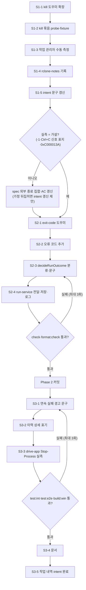

# Plan: rclone이 외부에서 강제 종료됐을 때 이해할 수 있는 실패 안내

- Intent: [INT-005](intent.md) | Tier: 2 | 작성일: 2026-11-03

> 기준: [spec.md](spec.md), 커밋 `41d3e3a`. Phase마다 검증을 통과한 뒤 커밋한다(Conventional Commits, 한 커밋 한 변경).

## 1. Tier 산정

**Tier 2 (Minor)** — 화면 문구 변경이 있어 AGENTS 6장 완료 기준(E2E·build:win)을 함께 적용한다.

| 근거 | 내용 |
| :--- | :--- |
| 범위 | 신규 shared 1(`exit-code.ts`)·수정 shared 1(`errors.ts`)·main 3(`run-output.ts`·`run-service.ts`·`scheduler.ts`)·화면 1(`HistoryDetail.tsx`)·probe 1·단위 테스트 3·문서 3. 약 13개 파일 |
| 안전 | 전송 시작 경로·게이트·`--max-delete`·사전 확인 판정 불변. 결과 **분류와 문구**만 바뀐다. 상태(`failed`)가 같아 `.partial` 안내·연속 실패 집계도 같다 |
| 파괴적 변경 | 없음. DB 스키마·IPC 계약·`zRunStatus` 불변, 마이그레이션 없음 |
| 브레이킹 체인지 | 내부 `itfRunOutcomeInput`에 필수 필드 `stderrTail` 추가(호출처 1곳·테스트). `ERROR_CODES`에 값 2개 추가(다운그레이드 시 해당 이력 행만 안 보임, spec R-3) |
| Tier 3이 아닌 이유 | 아키텍처·안전 게이트·저장 구조 변경이 없고, 변경은 순수 함수 중심이다 |

## 2. 실행 순서 (Steps)

### Phase 1 — 종료 코드 실측 (T-01, 선행: 없음)

| Step | 목표 | 대상 | 검증 | 롤백 |
| :--- | :--- | :--- | :--- | :--- |
| S1-1 | `f_ProbeKillOnTransfer`가 종료 방식(함수)을 받도록 확장. 기존 `copy-cancel-large`는 같은 결과(taskkill /T /F)를 유지 | `scripts/probes/rclone-probes.mjs:138-171`, 호출처 `:376` | `--only=copy-cancel-large` 재실행 후 `copy-cancel-large.exit.txt`가 `1` 그대로(`git diff`로 fixture 차이 없음 또는 크기 차이만) | 함수 되돌림 |
| S1-2 | `kill` 묶음 추가(`--only=kill`일 때만): `kill-taskkill-f`·`kill-taskkill-tf`·`kill-stop-process`·`kill-dotnet-kill`·`kill-cim-terminate`·`kill-ctrl-c`(spec FR-15). `kill-ctrl-c`는 도우미 PowerShell의 P/Invoke(`FreeConsole`→`AttachConsole(pid)`→`SetConsoleCtrlHandler(null,true)`→`GenerateConsoleCtrlEvent(CTRL_C_EVENT,0)`)로 보내고, 붙기 실패 시 이유를 남기고 그 방식만 건너뛴다. 임시 폴더·`--bwlimit`, `%SystemRoot%` 절대 경로, 인자는 숫자 pid만 | 같은 파일, `tests/fixtures/rclone/kill-*` | Windows PowerShell에서 `node scripts/probes/rclone-probes.mjs --only=kill`, fixture에 사용자 경로 없음(`grep`으로 드라이브 문자·사용자 이름 확인), `pnpm run format:check` | probe 블록·fixture 삭제 |
| S1-3 | 작업 관리자 "작업 끝내기" 1회 수동 측정(사용자 협조, 불가 시 notes에 "미측정") | `docs/knowhow/rclone-notes.md` | notes에 값 기록 | notes 되돌림 |
| S1-4 | rclone-notes #58~: 방식별 코드, Ctrl+C 종료 코드·`Signal received:` 기록 여부, 표지 없는 exit 1 구분 불가, 외부 종료 집합 확정 값, `0xC000013A` 재현 여부, Go 충돌 exit 2(소스 근거, spec R-2a) | `docs/knowhow/rclone-notes.md` | 9장 형식(날짜·버전·OS·명령·결과·영향) | notes 되돌림 |
| S1-5 | intent 문구 갱신: spec 머리말의 "intent Q2 결정과 다른 점"(충돌은 표지 기준, exit 1 + 신호 표지는 외부 종료, `0xC000013A` 조건부)을 S1-4 결과대로 intent 결정·제약·제안 결과에 반영 | `intent.md` | spec §6.4 표와 intent Q2 결정이 같음 | intent 되돌림 |

**분기 게이트**: 실측이 가설과 다르면 spec의 `EXTERNAL_KILL_EXIT_CODES`·AC-8·AC-13을 notes 근거로 먼저 고친 뒤 Phase 2로 간다. -1은 이번 건의 실제 값이므로 probe에서 재현되지 않아도 집합에 남긴다(spec R-2). 그 밖의 분기:
- `kill-ctrl-c`가 exit 1 + `Signal received:` → FR-3a·AC-17 유지. 표지가 없거나 붙기 실패 → spec에서 FR-3a·AC-17·§6.4 해당 행을 지우고 R-1을 "구분 불가"로 되돌린다.
- `kill-ctrl-c`(또는 다른 방식)가 `0xC000013A` → 외부 종료 집합에 추가하고 FR-4a·AC-16 첫 문장을 지운다. 재현되지 않으면 그대로 둔다.
- intent 가정이 뒤집히면(예: `taskkill /F`가 1이 아님) intent 제약 갱신을 사용자에게 제안한다.

커밋: `test: INT-005 외부 종료 방식별 rclone 종료 코드 probe와 fixture 추가`, `docs: INT-005 외부 종료 코드 실측 기록`(S1-4·S1-5와 게이트에 따른 spec 갱신)

### Phase 2 — 분류·표기 (T-02, 선행: Phase 1)

| Step | 목표 | 대상 | 검증 | 롤백 |
| :--- | :--- | :--- | :--- | :--- |
| S2-1 | shared 종료 코드 도우미(spec §6.1): `toInt32ExitCode`·`formatExitCode`·`formatExitCodeForLog`·`classifyAbnormalExit`·`EXTERNAL_KILL_EXIT_CODES`·NTSTATUS 이름 표. 신규 파일 가이드(`docs/guide/File.tsx.guide`) 상단 JSDoc·import 섹션 | 신규 `src/shared/exit-code.ts`, 신규 `tests/unit/exit-code.test.ts` | AC-1·AC-2, `shared-boundary.test.ts` 통과 | 파일 삭제 |
| S2-2 | 오류 코드 `RCLONE_KILLED`·`RCLONE_CRASHED`와 기본 메시지(FR-9) | `src/shared/errors.ts:7-42`, `ERROR_MESSAGES` | `pnpm run typecheck`(Record 누락 시 실패) | 두 줄 삭제 |
| S2-3 | `decideRunOutcome` 분류(spec §6.4)·문구(FR-8)·Go 충돌 표지(FR-5, JSON 아닌 줄의 `panic: `·`fatal error: `·`Exception 0x`)·신호 표지(FR-5a, JSON `msg`의 `Signal received: `), 입력에 `stderrTail`. 표지 검사는 파일 내부 `f_HasGoCrashMarker`·`f_HasSignalMarker`. 기존 `exit ${code}` 표기를 `formatExitCode`로 | `src/main/parsers/run-output.ts:78-158`, `tests/unit/run-output.test.ts` | AC-3~AC-8·AC-15~AC-17(AC-8·AC-17은 S1-2 fixture의 종료 코드·stderr를 읽어 사용, 충돌 표지는 합성 문자열임을 주석에 명시), 기존 테스트 전부 통과 | 함수 되돌림 |
| S2-4 | run-service: `decide`에 `result.stderrTail` 전달, 이력 `exitCode` 정규화 저장(FR-10), 로그 `exit=` 표기(FR-11, `:945`·`:1093`·`:1134`) | `src/main/services/run-service.ts:870-884`, `:945`, `:1091-1103`, `:1134` | `pnpm run check`, run-service 관련 단위 테스트, AC-11은 Phase 3 S3-3 실측으로 확인 | 해당 hunk 되돌림 |

커밋: `feat: INT-005 외부 종료·충돌 종료 코드 분류와 int32 표기` (S2-1~S2-4를 한 기능으로 묶음. 테스트 포함)

### Phase 3 — 화면·알림·문서 (T-03, 선행: Phase 2)

| Step | 목표 | 대상 | 검증 | 롤백 |
| :--- | :--- | :--- | :--- | :--- |
| S3-1 | 연속 실패 경고 문구 분기(FR-14), 집계 불변. 자동 알림은 `ERROR_MESSAGES`로 자동 반영(AC-9) | `src/main/services/scheduler.ts:260-275`, `tests/unit/scheduler.test.ts` | AC-9·AC-10 | hunk 되돌림 |
| S3-2 | 이력 상세 종료 코드 표기(FR-12). spec Q-3 결정: 목록 배지는 추가하지 않는다. 상세 메시지로 원인이 바로 읽히는지 S3-3에서 보고, 부족할 때만 상세 headline에 "외부 종료로 보임" 보조 표기 추가 | `src/pages/HistoryDetail.tsx:72-76` | AC-12(단위: `formatExitCode`, 화면: S3-3) | hunk 되돌림 |
| S3-3 | 실측 확인: `pnpm run build` 뒤 `node scripts/dev/drive-app.mjs`로 임시 프로필에서 로컬 임시 폴더 copy(`--bwlimit` 같은 큰 파일) 실행 중 PowerShell `Stop-Process -Id <rclone pid> -Force` | (코드 변경 없음) | AC-11·AC-13: 실행 결과·이력 목록 title·이력 상세 문구, 로그 끝 줄 `exit=-1(0xFFFFFFFF)`, 콘솔 오류 0 | - |
| S3-4 | 문서: CHANGELOG 한 줄, MVP_SPEC §8.6에 외부 종료·충돌 행, README 해당 시 | `docs/CHANGELOG.md`, `docs/specs/MVP_SPEC.md:1246-1259` | 문구가 spec FR-8과 같음 | 문서 되돌림 |
| S3-5 | 완료 기록: `docs/works/` 작업 내역, intent 태스크 체크·done 이동은 `intent-manager` 절차로 | `docs/works/WORKS.md`·`WORKS_HISTORY.md`, `docs/intent/` | INDEX 재작성 확인 | 기록 되돌림 |

커밋: `feat: INT-005 연속 실패 경고와 이력 상세 종료 코드 표기`, `docs: INT-005 외부 종료 안내 사용자 문서 갱신`

## 3. Intent 태스크 매핑

| plan Step | intent 태스크 | 비고 |
| :--- | :--- | :--- |
| S1-1, S1-2, S1-3, S1-4, S1-5 | T-01 [P2] probe `kill` 묶음 | 분기 게이트·intent 문구 갱신 포함 |
| S2-1, S2-2, S2-3, S2-4 | T-02 [P2] decideRunOutcome 분류·문구·표기·단위 테스트 | S2-4(run-service 저장·로그 표기)는 T-02의 "종료 코드 표기"에 포함 |
| S3-1, S3-2, S3-3, S3-4 | T-03 [P3] 실행 결과·이력·알림 문구, drive-app 확인, CHANGELOG | |
| S3-5 | (intent.md에 태스크 미분해) | 공통 완료 절차(AGENTS 7장·intent-manager) |

## 4. 검증 계획 (DoD)

명령은 Windows PowerShell에서 실행한다(WSL에는 node가 없음).

| 단계 | 조건 |
| :--- | :--- |
| Phase 1 | probe 실행 성공, fixture 경로 가림 확인, `pnpm run format:check` |
| Phase 2 (Tier 2) | `pnpm run check`(typecheck·oxlint·eslint·단위) 통과, 신규·변경 테스트 AC-1~AC-8·AC-15~AC-17 통과, `pnpm run format:check` |
| Phase 3 | `pnpm run check`·`format:check`, AC-9~AC-13, `pnpm run test:int` 통과(기존 실행 통합 테스트가 새 분류로 깨지지 않는지), `pnpm run test:e2e` 통과(콘솔 오류 0), `pnpm run build:win` 성공 |
| 문서 | CHANGELOG 한 줄, rclone-notes #58~, MVP_SPEC §8.6, `docs/works/` 기록 |

AGENTS 6장 대응: 파서 변경 → 테스트 추가·`test:int` / 화면 변경 → `test:e2e`·`build:win` / 사용자에게 보이는 변경 → CHANGELOG / 새 rclone 동작 → rclone-notes.

## 5. 리스크 · 파급

| 리스크 | 영향 | 대응 |
| :--- | :--- | :--- |
| 실측이 가설과 다름(spec R-2) | 외부 종료 집합·AC 변경 | Phase 1 분기 게이트에서 spec 먼저 갱신 |
| exit 1 구분 불가(spec R-1) | 신호 기록 없이 강제 종료된 경우(`taskkill /F`·작업 관리자)는 여전히 일반 오류 | 한계를 notes·MVP_SPEC에 기록. Ctrl+C 계열은 신호 표지로 구분(FR-3a, T-01 확정 시) |
| rclone 신호 처리기가 copy·sync에서 켜지지 않음(spec R-1, `registerOnce`) | FR-3a가 동작하지 않음 | `kill-ctrl-c` 실측으로 확인, 안 켜지면 게이트에서 FR-3a 삭제 |
| 표지 오탐(로그 메시지에 같은 문자열, spec E-8c) | 충돌·외부 종료 오분류 | 충돌 표지는 JSON 아닌 줄만, 신호 표지는 JSON `msg` 시작만 검사. AC-17 셋째 문장으로 확인 |
| 소스 근거와 실제 rclone 버전 차이(spec R-2a) | 신호 종료 코드·로그 문구가 다를 수 있음 | T-01을 앱이 쓰는 rclone으로 실행해 fixture 기준으로 테스트 |
| 오분류(Go 충돌 표지 누락, spec R-4) | 문구만 다름. 상태·게이트 같음 | 수용 |
| 새 오류 코드의 다운그레이드 호환(spec R-3) | 이전 버전에서 해당 이력 행만 안 보임(삭제 안 됨) | 수용, 문서화 안 함 |
| 합성 Go 충돌 문자열 테스트(spec R-5) | 실제 출력과 다를 수 있음 | Go 런타임 형식(`panic: `·`fatal error: ` 줄 시작)만 검사해 형식 의존 최소화 |
| `itfRunOutcomeInput` 필수 필드 추가 | 컴파일 오류로 누락 호출처가 드러남 | 호출처 1곳(`run-service.decide`)과 테스트만 수정 |

- 데이터 마이그레이션: 없음. 예전 레코드는 표기만 정규화(FR-12).
- 롤백 기준: Phase 2·3 검증이 3회 수정 루프 안에 통과하지 못하거나, 기존 실행 결과(취소·3·7·0) 테스트가 깨지면 해당 Phase 커밋을 되돌린다. 안전 게이트 관련 테스트가 하나라도 바뀌면 설계 결함으로 보고 code-planner로 돌아간다.

## 6. 실행 흐름

