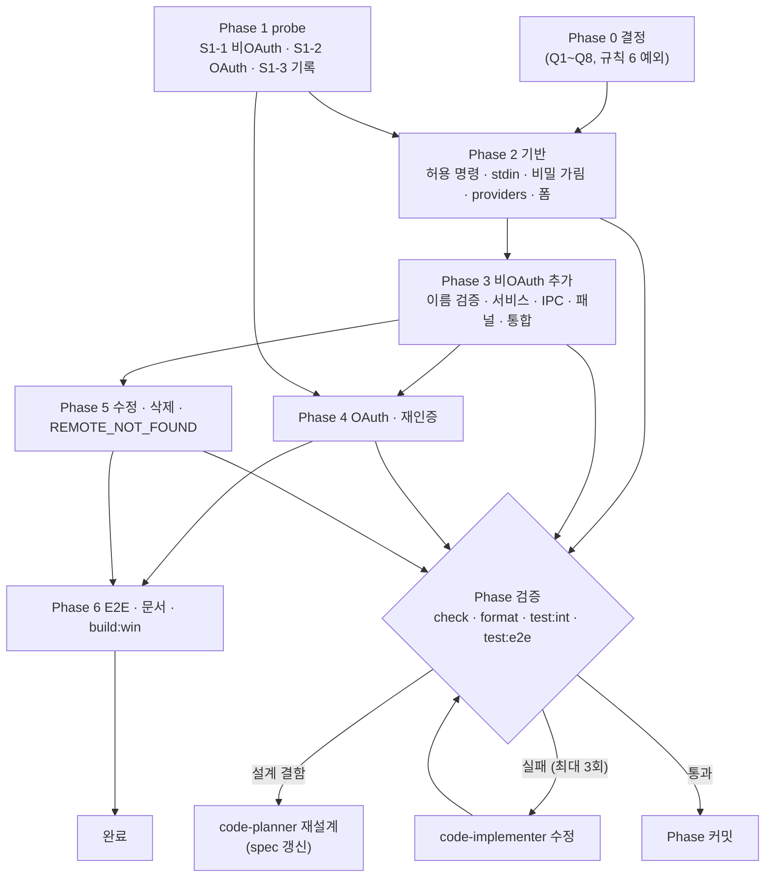

# Plan: 앱에서 rclone remote 추가·수정·삭제·재인증

- Intent: [INT-006](intent.md) | Tier: 3 | 작성일: 2026-11-03 | 완료: 2026-11-03

> 기준: [spec.md](spec.md), 커밋 `2215254`. Phase마다 검증 통과 뒤 커밋한다.
> Phase 0(결정)이 끝나기 전에는 Phase 2 이후 구현을 시작하지 않는다. Phase 1(probe)은 결정과 무관하게 먼저 해도 된다.

## 1. Tier 산정

**Tier 3 (Major)**

| 근거 | 내용 |
| :--- | :--- |
| 범위 | main(rclone 명령·프로세스·서비스·IPC)·preload·shared·renderer(새 패널·창 4개)·테스트(단위·통합·E2E)·문서. 새 파일 약 15개, 수정 약 15개 |
| 안전 규칙 | 허용 명령 목록 확장(안전 규칙 1), conf 값 읽기 예외(안전 규칙 6, 승인 필요), 비밀 값 처리 |
| 파괴적 변경 | 사용자 rclone.conf를 rclone을 통해 바꾸고 지운다. 삭제 흐름이 작업의 자동 실행·OS 예약을 끈다 |
| 브레이킹 체인지 | 없음. DB 스키마 변경 없음. 기존 `remotes:*`(북마크) IPC는 그대로 |

## 2. 실행 순서 (Steps)

### Phase 0 — 결정 (선행: 없음, 코드 변경 없음)

| Step | 목표 | 대상 | 검증 | 롤백 |
| :--- | :--- | :--- | :--- | :--- |
| S0-1 | spec §10 Q1~Q8 결정. 특히 Q2(안전 규칙 6 예외) — **완료 2026-11-03** | `intent.md` 미해결 질문 체크, `AGENTS.md` 규칙 1(rcd 조건)·6(redacted 예외), `rclone-notes.md` #39~#45 | 사용자 확인 | 문서 되돌림 |
| S0-2 | 이름 변경 미지원이면 INBOX 캡처 — **완료 2026-11-03** | `docs/intent/_ideas/INBOX.md` | — | 라인 제거 |

### Phase 1 — T-01 probe (선행: 없음)

| Step | 목표 | 대상 | 검증 | 롤백 |
| :--- | :--- | :--- | :--- | :--- |
| S1-1 | 임시 conf로 비OAuth 흐름 실측(notes #39~#44를 스크립트로 재현): `config providers`, rcd `config/create`·`update`(local·memory·alias·IsPassword 종류·Sensitive 종류)·인증 없는 401·`core/quit` 뒤 종료, `config delete`, `config redacted`, 이름 규칙(대소문자 중복 포함), 암호화 conf | `scripts/probes/rclone-probes.mjs`(config 섹션 추가), `tests/fixtures/rclone/config-*` | 스크립트 실행, fixture에 실제 경로·비밀 없음(grep) | 섹션·fixture 삭제 |
| S1-2 | OAuth 수동 실측: rcd `config/create` drive 질문 흐름(notes #45 이후 단계), `config_is_local=true` 뒤 rcd 안 브라우저 열기·주소 출력·HTTP 요청 대기, 취소(kill) 뒤 conf 상태, 53682 포트 점유 시 오류, 재인증(rc `config/update` 질문 흐름 또는 `config reconnect`)·취소 시 토큰 보존 | 수동 실행, 출력에서 토큰·계정 제거 후 fixture | 사람이 확인, fixture grep | fixture 삭제 |
| S1-3 | 실측 기록과 spec `[probe]` 갱신 | `docs/knowhow/rclone-notes.md`, `spec.md` §6.4·§7 | 문서 검토 | 문서 되돌림 |

### Phase 2 — T-02 providers·폼 기반 (선행: S1-1, Phase 0)

| Step | 목표 | 대상 | 검증 | 롤백 |
| :--- | :--- | :--- | :--- | :--- |
| S2-1 | 허용 명령 확장과 인자 생성 함수 | `src/main/rclone/command-builder.ts`, `tests/unit/command-builder.test.ts` | `config show`·`dump`·`edit`·`password` 거부, 새 명령 허용, 차단 플래그 회귀 테스트 | revert |
| S2-2 | rcd 세션: 시작(`127.0.0.1:0`, 실행마다 인증 토큰 env)·포트 읽기·`fetch` 호출(허용 경로 `config/create`·`config/update`·`core/quit`만)·종료·시간 제한 | `src/main/rclone/rc-session.ts`(신규), `process.ts` `buildRcloneEnv` 인자, 단위 테스트 | 허용 경로 밖 거부, 토큰이 인자에 없음, 종료 보장, 기존 테스트 통과 | revert |
| S2-3 | 비밀 가림 함수(인자·stderr) | `src/main/lib/secret-redact.ts`(신규), 단위 테스트 | 비밀 키·obscure 값이 `***`로 바뀜 | revert |
| S2-4 | providers 파서·타입·zod | `src/main/parsers/rclone-providers-parser.ts`, `src/shared/types/remote-config.ts`, `src/shared/schemas/remote-config.ts`, fixture 기반 테스트 | 숨김 제외·비밀 판정·OAuth 판정·모르는 필드 무시(E-10) | revert |
| S2-5 | 동적 폼 컴포넌트(고급 접기, 비밀 입력, 필수 검사) | `src/pages/RemoteConfigForm.tsx`·`.module.css` | `pnpm run check`, 컴포넌트 단위 테스트(있으면) | revert |

### Phase 3 — T-03 비OAuth 추가 (선행: Phase 2)

| Step | 목표 | 대상 | 검증 | 롤백 |
| :--- | :--- | :--- | :--- | :--- |
| S3-1 | 새 이름 검증 | `src/shared/remote-name.ts`(`validateNewRemoteName`), 단위 테스트 | AC-2 | revert |
| S3-2 | 오류 코드 추가 | `src/shared/errors.ts` | 타입 검사 | revert |
| S3-3 | 서비스: providers 캐시·create(rcd `config/create`)·목록 재감지 | `src/main/services/remote-config-service.ts`(신규), 단위 테스트(가짜 run) | AC-3 인자 검사, `remoteOps.run` 경유 | revert |
| S3-4 | IPC·preload | `src/shared/ipc-contract.ts`, `src/main/ipc/remote-config.ts`(신규), `src/main/ipc/register.ts`, `src/preload/*` | 타입 검사, 헤드리스에서 미등록(E-8) | revert |
| S3-5 | 설정 화면 패널·추가 창, 추가 뒤 env 재감지 | `src/pages/RemoteConfigPanel.tsx`, `RemoteConfigEditor.tsx`, `SettingsPage.tsx`, `src/stores/rclone-env-store.ts` | 수동 확인(`scripts/dev/drive-app.mjs --dev`) | revert |
| S3-6 | 통합 테스트: 임시 conf에 local·memory·alias 추가 | `tests/integration/remote-config.test.ts` | `pnpm run test:int`, AC-1 | 파일 삭제 |

### Phase 4 — T-04 OAuth·재인증 (선행: S1-2, Phase 3)

| Step | 목표 | 대상 | 검증 | 롤백 |
| :--- | :--- | :--- | :--- | :--- |
| S4-1 | 인증 세션: 한 건만, 10분 제한, 취소, 범용 질문 폼 흐름(`remoteConfig:answer`, `config_is_local`만 자동 true, 질문 20개 한도), 주소 추출(127.0.0.1만), 포트 충돌 판정, 새로 만든 이름만 정리 | `src/main/services/remote-auth-session.ts`(신규), 출력 파서, 단위 테스트(fixture·가짜 프로세스) | AC-6 단위 수준, FR-10·FR-12 | revert |
| S4-2 | 재인증(S1-2에서 정한 방식), 인증 만료 힌트에 버튼 연결 | 서비스·IPC, `rclone-env-parser.ts` 힌트 문구 | AC-7 단위 수준 | revert |
| S4-3 | 앱 종료 시 세션 정리 | `src/main/index.ts` before-quit 흐름 | 단위·수동(E-7) | revert |
| S4-4 | 대기 창(남은 시간·취소·주소)과 질문 폼(Drive client_id 안내 포함) | `src/pages/RemoteAuthModal.tsx` | 수동 확인(실제 Drive, 사람이 로그인) | revert |

### Phase 5 — T-05 수정·삭제·없는 remote (선행: Phase 3, Q2 결정)

| Step | 목표 | 대상 | 검증 | 롤백 |
| :--- | :--- | :--- | :--- | :--- |
| S5-1 | 참조 조회(작업·예약 종류·북마크·다른 conf 작업 수) | `remote-config-service.ts`, 단위 테스트 | FR-19, AC-8 수치 | revert |
| S5-2 | 수정: redacted 파서·이중 제거·바뀐 칸만 update | `src/main/parsers/rclone-config-parser.ts`, 서비스·IPC, 편집기 | AC-4·AC-5 | revert |
| S5-3 | 삭제: 자동 실행 끄기 → `osScheduler.idle()` 확인 → `config delete` → 재감지, 실패 시 멈춤 | 서비스(의존성: `clsJobStore`·`clsOsScheduler`), `RemoteDeleteModal.tsx` | AC-9·AC-10 단위(가짜 스케줄러), 순서 테스트 | revert |
| S5-4 | `REMOTE_NOT_FOUND` 실행 전 확인 | `src/main/services/job-context.ts`, 단위 테스트 | AC-12(비교·수동·자동·헤드리스 경로 공통) | revert |
| S5-5 | "remote 없음" 표시(작업 목록·작업 화면·북마크) | `JobSidebar.tsx`, `JobWorkspace.tsx`, `RemoteBookmarksPanel.tsx` | 수동 확인 | revert |

### Phase 6 — T-06 문서·E2E·패키징 (선행: Phase 3~5)

| Step | 목표 | 대상 | 검증 | 롤백 |
| :--- | :--- | :--- | :--- | :--- |
| S6-1 | E2E: 임시 `RCLONE_CONFIG`로 추가 → 수정 → 삭제(참조 작업 예약 끄기 포함) | `tests/e2e/remote-config.spec.ts` | `pnpm run test:e2e`, 콘솔 오류 0(AC-14) | 파일 삭제 |
| S6-2 | README 1.1(CLI 안내 → 앱 안내 + CLI 대안), CHANGELOG 한 줄, MVP_SPEC 반영 표, rclone-notes | 문서 | 검토 | 되돌림 |
| S6-3 | 설치본 빌드 | `pnpm run build:win` | 성공 | — |

## 3. Intent 태스크 매핑

| Intent 태스크 | plan Step |
| :--- | :--- |
| (intent 미해결 질문 결정, 태스크 없음) | S0-1, S0-2 |
| T-01 probe | S1-1, S1-2, S1-3 |
| T-02 providers 파서·동적 폼 | S2-1, S2-2, S2-3, S2-4, S2-5 |
| T-03 remote 추가(비OAuth) | S3-1, S3-2, S3-3, S3-4, S3-5, S3-6 |
| T-04 OAuth 추가·재인증 | S4-1, S4-2, S4-3, S4-4 |
| T-05 수정·삭제 | S5-1, S5-2, S5-3, S5-4, S5-5 |
| T-06 문서·E2E | S6-1, S6-2, S6-3 |

S2-1~S2-3(허용 명령·stdin·비밀 가림)은 T-03~T-05가 함께 쓰는 기반이라 T-02에 넣었다.

## 4. 검증 계획 (DoD)

Tier 3 기준. Phase마다 아래 중 해당 항목을 통과해야 다음 Phase로 간다.

| 항목 | 명령·방법 | 적용 Phase |
| :--- | :--- | :--- |
| 타입·린트·단위 | `pnpm run check` | 2~6 |
| 포맷 | `pnpm run format:check` | 2~6 |
| 통합 | `pnpm run test:int`(임시 conf, rclone 없으면 skip 사유 출력) | 3, 5 |
| E2E | `pnpm run build` → `pnpm run test:e2e`, 콘솔 오류 0 | 6 (화면을 바꾼 3~5도 마지막에 한 번) |
| 패키징 | `pnpm run build:win` | 6 |
| 안전 단위 테스트 | 허용 목록(`config show`·`dump` 거부), 차단 플래그 회귀, 비밀 가림, 실행 인자에 평문 없음 | 2, 3, 5 |
| fixture 검사 | `tests/fixtures/rclone/config-*`에 실제 경로·remote 이름·토큰·obscure 값 없음 | 1 |
| 수동 | OAuth(실제 Drive, 사람이 로그인), 앱 종료 중 정리 | 4 |
| 문서 | CHANGELOG 한 줄, rclone-notes, `docs/works/` 기록 | 각 Phase 끝 |

## 5. 리스크 · 파급

| 항목 | 내용 | 대응·롤백 기준 |
| :--- | :--- | :--- |
| 브레이킹 체인지 | 없음. 기존 북마크 IPC·DB 그대로 | — |
| 데이터 마이그레이션 | 없음 | — |
| 사용자 conf 변경 | 앱이 rclone으로 conf를 쓰고 지운다. 버그면 사용자 remote가 사라질 수 있다 | 삭제는 확인 창 필수, `remoteOps` 직렬화, 통합·E2E는 임시 conf만. 사용자 conf에서 이상이 보이면 해당 Phase revert |
| 안전 규칙 6 완화(Q2, 승인됨) | 비밀 값이 메모리에 들어올 수 있다 | 이중 제거·원문 비보관 테스트 |
| rcd 사용(Q1) | 떠 있는 동안 같은 PC 프로세스가 포트에 접근할 수 있다 | loopback·실행마다 인증 토큰·허용 경로만·흐름 뒤 즉시 종료, 통합 테스트(AC-15) |
| 자동 실행 끄기 | 삭제 흐름이 사용자 작업의 예약을 끈다 | 확인 창 문구로 명시, 결과 문구에 꺼진 작업 수. 다시 켜기는 사용자 몫 |
| OAuth 흐름 변화 | rclone 버전에 따라 출력이 바뀐다 | fixture 파서, 모르는 상태면 실패 + CLI 안내. `VERIFIED_RCLONE_VERSION`을 올릴 때 S1-2 재실행 |
| 실행 전 remote 확인(S5-4) | 모든 비교·실행에 rclone 호출 1회 추가, 오탐 시 실행이 막힌다 | 단위 테스트로 대소문자·작업별 conf 경우 확인. 오탐 발견 시 S5-4만 revert(나머지 독립) |

롤백 단위는 Step 커밋이다. Phase 5의 S5-3·S5-4는 서로 독립이라 따로 되돌릴 수 있다.

## 6. 실행 흐름

