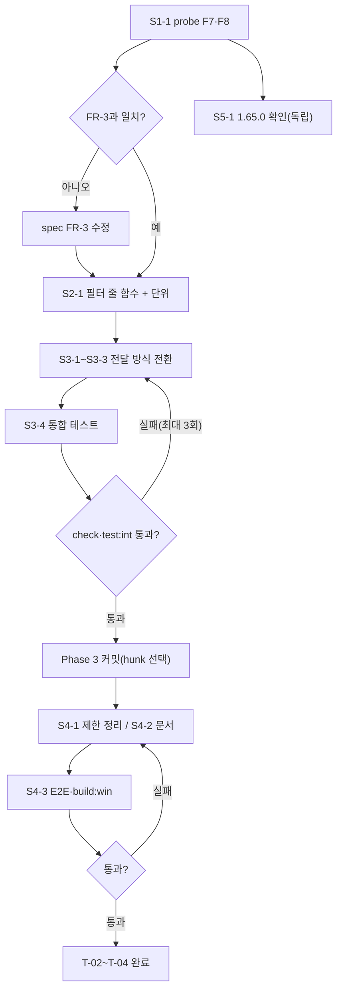

# Plan: 제외 패턴을 --filter-from 파일로 전달해 명령줄 전용 패턴 제한과 뒤 공백 버그 해소

- Intent: [INT-007](intent.md) | Tier: 3 | 작성일: 2026-11-03

> 기준: [spec.md](spec.md), 커밋 `d457138`. Phase마다 검증을 통과한 뒤 커밋한다.
> 작업 트리에 INT-006 미커밋 변경이 같은 파일(`command-builder.ts`·`index.ts`·`rclone-probes.mjs`)에 있다. 커밋은 INT-007 hunk만 골라 담는다.

## 1. Tier 산정

**Tier 3 (Major)**

| 근거 | 내용 |
| :--- | :--- |
| 범위 | shared 2·main 5(빌더·서비스 3·index 주석)·probe·테스트(단위 3~4·통합 1)·문서 3. 새 파일 없음, 수정 약 14개 |
| 안전 | 실제 sync/copy의 제외 규칙 전달 방식이 바뀐다. 제외가 덜 적용되면 원치 않는 복사·삭제가 날 수 있다(AGENTS 완료 기준: 빌더·안전 로직 변경 → `test:int`) |
| 파괴적 변경 | 없음. DB 스키마·IPC 계약 변경 없음 |
| 브레이킹 체인지 | 내부 타입(`itfEffectiveExcludes`·`itfExcludeArgs`)만. 저장 제한은 완화(16,000자 예산 삭제) |

## 2. 실행 순서 (Steps)

### Phase 1 — probe 보강 (선행: 없음)

| Step | 목표 | 대상 | 검증 | 롤백 |
| :--- | :--- | :--- | :--- | :--- |
| S1-1 | 유니코드 공백(U+0085·U+00A0·U+2028·U+3000·U+FEFF 등)과 끝 `\ ` 해석을 probe F7·F8로 저장소에 남김(spec §6.3 사전 실측 결과를 fixture로) | `scripts/probes/rclone-probes.mjs` `filter` 묶음, fixture `filter-*`, `rclone-notes.md` #55~ | `node scripts/probes/rclone-probes.mjs rclone --only=filter`, fixture에 사용자 경로 없음, `oxfmt --check` | probe 블록·fixture·notes 되돌림 |

결과가 spec FR-3과 다르면(예: U+00A0을 지우지 않음) FR-3의 바꿀 문자 집합을 notes 근거로 고친 뒤 Phase 2로 간다.

### Phase 2 — 필터 줄 생성 (T-02, 선행: S1-1)

| Step | 목표 | 대상 | 검증 | 롤백 |
| :--- | :--- | :--- | :--- | :--- |
| S2-1 | `toFilterExcludeLine`·`buildFilterFileContent` 추가(기존 함수는 아직 유지) | `src/shared/exclude-patterns.ts`, `tests/unit/exclude-patterns.test.ts` | AC-1·AC-3·AC-6 단위 테스트, `pnpm run check` | 커밋 되돌림 |

### Phase 3 — 전달 방식 전환 (T-02·T-03, 선행: S2-1)

타입이 함께 바뀌어 한 커밋으로 한다.

| Step | 목표 | 대상 | 검증 | 롤백 |
| :--- | :--- | :--- | :--- | :--- |
| S3-1 | `itfEffectiveExcludes`를 `{ patterns, fileContent, snapshotHash }`로, `HASH_VERSION = 2`, 제어문자 방어(`VALIDATION`) | `src/main/services/effective-excludes.ts`, `tests/unit/effective-excludes.test.ts` | AC-4·AC-7 | 커밋 되돌림 |
| S3-2 | `itfExcludeArgs { filterFile }`, `f_PushCommon`이 `--filter-from F`만, 머리 주석·JSDoc | `src/main/rclone/command-builder.ts`, `tests/unit/command-builder.test.ts` | AC-2·AC-5, 차단 목록 테스트 통과 | 〃 |
| S3-3 | 호출부 전환 | `compare-service.ts`(348~358), `run-service.ts`(974), `exclude-file.ts`·`index.ts` 주석 | `pnpm run check`, AC-12(기존 `run.gates` 통합) | 〃 |
| S3-4 | 통합 테스트: 특수 패턴·200개 동일성·끝 공백 해석 | `tests/integration/excludes-file.test.ts` | AC-8·AC-9·AC-10, `pnpm run test:int` | 〃 |

### Phase 4 — 제한 정리와 문서 (T-04, 선행: S3-*)

| Step | 목표 | 대상 | 검증 | 롤백 |
| :--- | :--- | :--- | :--- | :--- |
| S4-1 | `isFileSafePattern`·`planExcludeTransport`·`itfExcludeTransport`·`f_ArgChars` 삭제, `excludesSaveIssue` 합계만, 공용 `#`·`;` 문구(FR-9), 상수 3개 삭제 | `src/shared/exclude-patterns.ts`, `src/shared/option-limits.ts`, 관련 단위 테스트 | AC-11, `pnpm run check`, `rg "isFileSafePattern\|EXCLUDE_ARG_ONLY\|EXCLUDE_FILE_MIN\|exclude-from" src` 0건 | 커밋 되돌림 |
| S4-2 | 문서 | `MVP_SPEC.md`(99·291·941~948·1077·1088행 근처), `rclone-notes.md` #18·#20 "영향" 갱신, `CHANGELOG.md` 한 줄 | 문서 검토 | 〃 |
| S4-3 | 화면·패키징 확인 | — | AC-13: `pnpm run build` 뒤 `pnpm run test:e2e`(콘솔 오류 0), `pnpm run build:win` | — |

### Phase 5 — 최소 버전 확인 (T-05, 선행: S1-1, 다른 Phase와 독립)

| Step | 목표 | 대상 | 검증 | 롤백 |
| :--- | :--- | :--- | :--- | :--- |
| S5-1 | rclone 1.65.0으로 `filter` 묶음 실행, 1.75.1 fixture와 비교 | 임시 폴더의 1.65.0(저장소 밖), 다르면 notes 기록 | 결과 비교표, 다르면 대응 결정(최소 버전 상향 등) | notes 되돌림 |

## 3. Intent 태스크 매핑

| Plan Step | Intent 태스크 | 비고 |
| :--- | :--- | :--- |
| (완료) | T-01 | probe `filter` F1~F6, notes #46~#50 |
| S1-1 | T-01 보강 | T-01은 체크된 상태. 보강 결과는 T-02의 선행 근거 |
| S2-1 | T-02 | |
| S3-1·S3-2 | T-02 | 계획 토큰 버전은 올리지 않음(spec §10 Q-4) |
| S3-3·S3-4 | T-03 | |
| S4-1·S4-2·S4-3 | T-04 | |
| S5-1 | T-05 | |

## 4. 검증 계획 (DoD)

AGENTS.md 6장과 Tier 3 기준.

- [x] `pnpm run check`(typecheck·oxlint·eslint·단위) 통과 — Phase마다
- [x] `pnpm run format:check` 통과 — Phase마다
- [x] `pnpm run test:int` 통과(rclone 1.75.1) — Phase 3 이후
- [x] `pnpm run test:e2e` 통과·콘솔 오류 0, `pnpm run build:win` 성공 — Phase 4
- [x] AC-1~AC-13 충족 표를 Phase 4 보고에 남긴다
- [x] `docs/CHANGELOG.md` 한 줄, `rclone-notes.md` 기록, `docs/works/` 기록

### 검증 결과 (2026-11-03)

| AC | 검증 | 결과 |
| :--- | :--- | :--- |
| AC-1·AC-3·AC-3b·AC-6 | `tests/unit/exclude-patterns.test.ts` | 통과 |
| AC-2·AC-5 | `tests/unit/command-builder.test.ts` | 통과 |
| AC-4·AC-7 | `tests/unit/effective-excludes.test.ts` | 통과 |
| AC-8·AC-9·AC-10 | `tests/integration/excludes-file.test.ts` (rclone 1.75.1) | 통과 |
| AC-11 | `tests/unit/exclude-patterns.test.ts` (길이 예산 없음) | 통과 |
| AC-12 | `tests/integration/run.gates.test.ts` (PLAN_STALE) | 통과 |
| AC-13 | `pnpm run test:e2e`(15, 콘솔 오류 0)·`pnpm run build:win` | 통과 |

명령: `pnpm run check`(단위 76파일 1,289)·`format:check`·`test:int` 77(+19 skip)·`test:e2e` 15·`build:win`.

## 5. 리스크 · 파급

| 리스크 | 영향 | 대응 / 롤백 기준 |
| :--- | :--- | :--- |
| 제외 규칙이 덜 적용됨 | sync가 빼야 할 파일을 복사하거나 대상 전용 파일을 지움 | AC-8~AC-10이 실패하면 Phase 3을 커밋하지 않는다. 배포 뒤 발견되면 Phase 3 커밋을 되돌린다(DB 변경이 없어 바로 되돌릴 수 있음) |
| 유니코드 공백 처리 차이 | 끝 공백이 NBSP 등인 패턴이 다르게 적용 | S1-1 결과로 FR-3 집합 확정. 화면 입력은 trim하므로 영향은 IPC·이전 데이터뿐 |
| 1.65.0 동작 차이 | 낮은 버전 사용자의 제외 규칙 오동작 | S5-1. 다르면 최소 버전 상향(`detect.ts`)을 별도 결정 |
| INT-006 변경과 같은 파일 | 커밋이 섞임 | hunk 단위 스테이징(`git add -p`), 커밋 전 `git diff --cached` 확인 |
| 해시 버전 변경 | 같은 세션의 기존 비교 결과가 무효 | 업데이트는 재시작을 거치므로 영향 없음. 마이그레이션 불필요 |

브레이킹 체인지: 없음(사용자 데이터·IPC 그대로). 데이터 마이그레이션: 없음.

## 6. 실행 흐름

