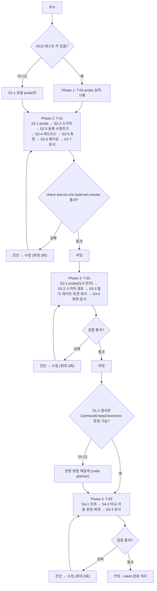

# Plan: OS 예약·헤드리스 실행·sync 오류 무시/백업 폴더·GCS 실측 후속

- Intent: [INT-003](intent.md) | Tier: 3 | 작성일: 2026-11-02

> spec: [spec.md](spec.md). 진행 순서는 intent를 따른다: T-04 → T-01 → T-03 → T-05.
> Phase마다 검증을 통과하면 커밋한다(한 커밋에 한 가지 변경).

## 1. Tier 산정

**Tier 3 (Major)**

- 범위: main 진입점(`index.ts`) 수명주기 분기, 새 서비스(`os-scheduler.ts`), 실행 서비스·게이트·명령 빌더·계획 토큰, shared 스키마, 화면(편집기·비교·이력), 패키징(NSIS·fuses), 설치 스모크. 30개 안팎 파일.
- 안전 로직 변경: `checkPlanSafety`의 오류 무시 차단 조건, `ALLOWED_COMMANDS`에 `backend features` 추가, 계획 토큰 버전 3 → 4.
- 파괴적 변경: 없음. DB DDL 마이그레이션 없음(`jobs.data` JSON 필드 추가, 읽기 기본값). 토큰 버전이 바뀌므로 업데이트 직후 남은 비교 결과는 다시 비교가 필요하다(메모리 캐시라 재시작이면 어차피 사라짐).
- OS 상태 변경: 사용자 작업 스케줄러에 예약을 만든다(제거 시 정리).

## 2. 실행 순서 (Steps)

### Phase 1 — T-04 GCS 실측 (선행: 테스트 버킷·키 제공)

**S1-1 `backend features`·빈 폴더 probe**
- 목표: `CanHaveEmptyDirectories` 값과 `directory_markers` 반영 여부, `전체` 범위 후 `createDirs` 잔존을 기록한다.
- 변경: `scripts/probes/rclone-probes.mjs`(로컬 임시 폴더 대상 `backend features`), GCS 쪽은 `tests/integration/gcs-acceptance.test.ts`에 확인 케이스 추가, `tests/fixtures/rclone/`(로컬 출력만).
- 선행: 없음(로컬 probe), GCS 확인은 환경 변수.
- 검증: probe 실행, `pnpm run test:int`(환경 변수 있음/없음 두 번 — 없으면 이유 출력 후 skip).
- 롤백: 테스트·probe 파일 되돌림(앱 코드 변경 없음).

**S1-2 실측 실행·기록**
- 목표: GCS 수용 테스트 skip 0으로 통과, 결과 기록.
- 변경: `docs/knowhow/rclone-notes.md`, `docs/CHANGELOG.md`(버킷명·키 경로 미기재).
- 검증: `pnpm run test:int` 출력에 GCS skip 없음. 문서에 remote·버킷 이름이 없는지 grep.
- 롤백: 문서만.
- 키가 없으면 이 Phase는 보류하고 Phase 2로 넘어간다. Phase 5(T-05)는 S1-1 결과가 있어야 시작한다.

### Phase 2 — T-01 OS 예약·헤드리스

**S2-1 작업 스케줄러 probe**
- 목표: spec §10에서 결정한 Q-1·Q-2·Q-8의 동작을 기록한다(설계는 바꾸지 않는다): `/Query /XML` stdout 인코딩(Q-1), `RestartOnFailure`가 0이 아닌 종료 코드로 재시작하지 않는지(Q-2), `ExecutionTimeLimit` 강제 종료 뒤 자식 프로세스가 남는지(Q-8). stdout 원본은 `decodeSchtasksOutput` 테스트용 fixture로 남긴다(사용자 경로 없는 임시 작업만).
- 변경: `scripts/probes/schtasks-probes.mjs`(신규, 임시 작업 `\rcloneGUI-probe\…`만 만들고 끝나면 지움, 더미 exe는 `cmd /c exit N` 대신 node 스크립트), 결과는 `docs/knowhow/`에 기록.
- 검증: Windows PowerShell에서 실행, 남은 probe 작업 0개 확인.
- 롤백: 스크립트 삭제.

**S2-2 shared 스키마·순수 함수**
- 목표: `zScheduleBackend`, `autoSync.backend`, `zRunTrigger`의 `os-scheduler`, `zRunJobAdditionalData`, `buildTaskXml`·`decodeSchtasksOutput`(순수) 추가.
- 변경: `src/shared/schemas/job.ts`·`common.ts`·`system.ts`(또는 새 파일), `src/main/services/os-scheduler.ts`(XML 부분), 화면 이력 trigger 표시 문구(`src/lib`·이력 화면).
- 검증: 단위 테스트 — 예전 데이터 읽기 기본값 `"app"`, patch에 backend 없을 때 기존 값 유지, XML 이스케이프(`&`·`<`·`"`), interval·daily·weekly → 트리거 변환, 요일 비트 → `DaysOfWeek`, `ExecutionTimeLimit=PT13H` 있음·`RestartOnFailure` 없음(FR-7), `decodeSchtasksOutput`(UTF-16 LE BOM·BOM 없는 UTF-16·코드페이지 출력, S2-1 fixture). `pnpm run check`.
- 롤백: 커밋 되돌림(데이터는 JSON 필드라 남아도 이전 버전이 무시 — zod 객체가 strip이면 확인 필요).

**S2-3 schtasks 실행 래퍼와 수명주기**
- 목표: `clsOsScheduler.register/unregister/list/reconcile`(`execFile` + `shell:false`, `\rcloneGUI\<jobId>`만), 작업 저장·삭제·자동 실행 끔·백엔드 변경 훅, 시작 시 reconcile(고아 삭제·exe 경로 재등록 — 작업 이름 목록만 얻고 작업마다 `/Query /TN … /XML`의 `<Command>`만 읽는다, 언어별 CSV·LIST 열에 기대지 않음, FR-10), `app.isPackaged` 아닐 때 비활성.
- 변경: `src/main/services/os-scheduler.ts`, `src/main/index.ts`(서비스 연결), `job-store` onChange 경로 또는 IPC `jobs` 핸들러, `scheduler.ts`(OS 백엔드 작업 건너뜀), `ipc-contract.ts`·`ipc/scheduler.ts`(`scheduler:osStatus`).
- 검증: 단위 — execFile을 주입한 가짜로 인자 배열 확인(사용자 문자열이 인자에 없음), reconcile 판정 표. 스케줄러 단위 — OS 백엔드 작업이 `pickDue`에서 빠짐. `pnpm run check`.
- 롤백: 커밋 되돌림. 이미 등록된 예약은 `schtasks /Delete /TN \rcloneGUI\ …`로 수동 정리(README 문구).

**S2-4 헤드리스 `--run-job`·second-instance**
- 목표: argv 파싱(첫 실행만)·`additionalData` 전달·진입 검사·`startAuto(jobId, "os-scheduler")`·종료 코드·GUI 전환(FR-12~FR-18), BUSY 대기열(FR-16: FIFO·같은 jobId 중복 없음·최대 60분 뒤 blocked·대기열이 비면 종료), 경로 확인 재시도(FR-22: 전송 전만 2분 간격 최대 3회), 앱 내부 제한 시간(FR-34: 12시간 넘으면 `killProcessTree` → `canceled` → 종료 코드 1).
- 변경: `src/main/index.ts`(창·트레이·스케줄러 생성을 함수로 분리, 헤드리스 분기, `f_ShowStartError` 헤드리스 무시), `src/main/services/run-service.ts`(`startAuto` trigger 인자), 진입 검사 순수 함수(`src/shared` 또는 `src/main/services`), 헤드리스 대기열·재시도·제한 시간(`src/main/services/`, 시계·타이머 주입).
- 검증: 단위 — 진입 검사 판정 표(작업 없음·꺼짐·앱 백엔드·일시정지·통과), argv·additionalData 파서(uuid 아님·여분 플래그), 대기열(중복 무시·순서·60분 초과 blocked·비면 종료 — 가짜 시계), 재시도(3회 뒤 실패·전송 시작 뒤 재시도 없음), 제한 시간(취소 경로 호출·종료 코드 1). 통합 — `tests/integration/auto-run.test.ts`에 trigger `os-scheduler` 이력, 두 작업을 잇달아 넣으면 둘 다 이력이 남음(AC-15). `pnpm run check`, `pnpm run test:int`.
- 롤백: 커밋 되돌림.

**S2-5 화면**
- 목표: 편집기 예약 방식 선택(개발 실행 비활성·이유), 암호화 conf 안내, 등록 실패·미등록 표시, 작업 목록 배지, 이력 "Windows 예약".
- 변경: 작업 편집기 자동 실행 영역(`src/pages/…`), `src/lib/job-form.ts`, 작업 목록, 이력 화면, 관련 `*.module.css`.
- 검증: `pnpm run check`, `tests/e2e/schedule.spec.ts`에 OS 선택 비활성(E2E는 패키징 아님) 확인, 콘솔 오류 0.
- 롤백: 커밋 되돌림.

**S2-6 패키징: 제거 정리·fuses·설치 스모크**
- 목표: FR-20·FR-21, AC-2~AC-7을 설치본으로 확인.
- 변경: `build/installer.nsh`(`${ifNot} ${isUpdated}`에서 PowerShell `Get-ScheduledTask -TaskPath "\rcloneGUI\" | Unregister-ScheduledTask -Confirm:$false`), `electron-builder.yml`(`electronFuses` — 26.18.0이 지원함을 확인, 새 의존성 없음, spec A-1), `scripts/dev/installer-smoke.mjs`(`--run-job` 시나리오: 임시 userData로 작업 생성 → OS 예약 등록 확인 → `schtasks /Run` → 이력·종료 코드 → 제거 후 예약 없음).
- 검증: `pnpm run build:win`, `pnpm run smoke:installer`, `pnpm run test:e2e`.
- 롤백: 커밋 되돌림. fuses만 문제면 해당 fuse만 끈다.

**S2-7 문서**
- 변경: AGENTS.md 안전 규칙 2(OS 예약도 `startAuto` 경유) 한 줄, MVP_SPEC 스케줄러 장·구현 반영, README(OS 예약·제거·재설치 후 첫 실행에서 복원·암호화 conf 미지원), CHANGELOG.
- 검증: `pnpm run format:check`.

### Phase 3 — T-03 백업 폴더

**S3-1 `--backup-dir` probe**
- 목표: **Q-5를 가장 먼저 확정한다(FR-35)**: `--backup-dir`을 줬을 때 dry-run·실제 실행 JSON 로그의 `skipped`·`msg` 문구, 백업 이동이 `--max-delete`에 세어지는지, 덮어쓴 파일의 백업 이동이 어떻게 찍히는지. 결과가 FR-35와 다르면 S3-3 전에 spec FR-35를 고친다. 그 밖에 동작 기록: 로컬 다른 드라이브(Q-4 — 결과와 상관없이 앱은 거부), 겹침 오류 메시지, GCS 서버 쪽 이동(환경 변수 있을 때).
- 변경: `scripts/probes/rclone-probes.mjs`, `tests/fixtures/rclone/`(백업 폴더 sync의 dry-run·실제 실행 출력 — 삭제만·덮어쓰기만·둘 다), `docs/knowhow/rclone-notes.md`.
- 검증: probe 실행(임시 폴더만).
- 롤백: probe·fixture 되돌림.

**S3-2 스키마·경로 검사**
- 목표: `options.backupDir`(읽기 기본 null), `checkBackupDir`(같은 remote·겹침 금지·형식).
- 변경: `src/shared/schemas/job.ts`, `src/shared/path-utils.ts`, `src/lib/job-form.ts`(화면 검증 공용).
- 검증: 단위 — 같은 경로·상위·하위·대소문자(설정별)·다른 remote·다른 로컬 드라이브 거부(AC-17)·같은 UNC 공유만 허용·WSL 경로. `pnpm run check`.
- 롤백: 커밋 되돌림.

**S3-3 실행 경로: 명령 빌더·게이트·토큰**
- 목표: FR-25~FR-28, FR-35.
- 변경: `command-builder.ts`(`backupDir` 입력 → `--backup-dir`), `run-gates.ts`(`checkPlanSafety` 조건, `SYNC_IGNORE_ERRORS_TEXT`), `plan-token.ts`(버전 4 + 백업 기준 경로), `run-service.ts`(`buildBackupSubdir`로 `YYYY-MM-DD_HHmmss_<jobId 앞 8자>` 결정, 사전 확인·실제 실행 공유, 로그 파일에 백업 위치), `src/main/parsers/log-parser.ts`(`f_Skip`: 지우는 파일의 백업 이동만 `delete`, 덮어쓰기 이동은 세지 않음 — S3-1 fixture 기준), `compare-service.ts`(토큰 입력).
- 검증: 단위 — `tests/unit/command-builder.test.ts`(백업 없는 sync + `--ignore-errors`는 여전히 차단, 있으면 통과), 게이트 표, 토큰 변화, `buildBackupSubdir`(로컬 시각·0 채움·jobId 앞 8자), 파서 fixture로 백업 폴더 사전 확인 삭제 수 = 계획 수(AC-16). 통합 — `run.sync.test.ts`·`run.gates.test.ts`에 백업 폴더로 삭제 파일 이동 확인(AC-10), 백업 폴더 + 덮어쓰기·삭제가 섞인 sync가 사전 확인·`--max-delete`에 막히지 않음. `pnpm run check`, `pnpm run test:int`.
- 롤백: 커밋 되돌림.

**S3-4 화면·문서**
- 목표: 편집기 백업 폴더 필드(sync만), 경고 문구, 삭제 확인 창·결과·이력 상세 표시, 안내(앱이 지우지 않음).
- 변경: `src/pages/JobOptionsFields.tsx`(또는 편집기), `src/lib/job-form.ts`, 삭제 확인 창·이력 상세, MVP_SPEC(금지 목록·FR-28), CHANGELOG.
- 검증: `pnpm run check`, `pnpm run test:e2e`(편집기 저장 거부·허용), `format:check`.
- 롤백: 커밋 되돌림.

### Phase 4 — T-05 빈 폴더를 만들 수 없는 대상 (선행: S1-1)

**S4-1 `backend features` 조회**
- 목표: FR-30.
- 변경: `command-builder.ts`(`ALLOWED_COMMANDS`에 `["backend","features"]`, `buildBackendFeaturesArgs`), 파서(`src/main/parsers/`, 순수 함수 + fixture), `remote-service.ts` 조회·캐시, `ipc-contract.ts`(`remotes:features`).
- 검증: 단위 — 허용 목록에 `backend` 다른 하위 명령은 여전히 거부, 파서 fixture(로컬 probe 출력), 캐시 키. `pnpm run check`.
- 롤백: 커밋 되돌림.

**S4-2 비교·자동 판정·화면**
- 목표: FR-31~FR-33.
- 변경: `src/shared/types/compare.ts`(`destCanHaveEmptyDirs`), `compare-service.ts`, 자동 noop 판정(`run-service.ts` 자동 게이트 쪽), 비교 화면 요약·목록, 편집기 경고.
- 검증: 단위 — noop 판정(false면 createDirs 무시, null·true면 지금과 같음). E2E — 로컬 대상은 표시 없음(콘솔 오류 0). GCS 환경이 있으면 통합 테스트로 AC-13.
- 롤백: 커밋 되돌림.

**S4-3 문서**
- 변경: MVP_SPEC E-6 반영, CHANGELOG, rclone-notes(필요 시).

## 3. Intent 태스크 매핑

| plan 단계 | intent 태스크 | 비고 |
| :--- | :--- | :--- |
| S1-1, S1-2 | T-04 | 키가 없으면 S1-2 보류 |
| S2-1 ~ S2-7 | T-01 | |
| S3-1 ~ S3-4 | T-03 | |
| S4-1 ~ S4-3 | T-05 | S1-1 결과 필요 |
| (없음) | T-02·T-06·T-07 | 취소(intent 결정 2026-11-02) |

## 4. 검증 계획 (DoD)

Tier 3 기준(AGENTS.md 6장):
- [ ] `pnpm run check` 통과(typecheck + oxlint + eslint + 단위)
- [ ] `pnpm run format:check` 통과
- [ ] 빌더·파서·안전 로직 변경에 단위 테스트 추가, `pnpm run test:int` 통과(GCS는 환경 변수 있을 때 skip 0)
- [ ] 화면·패키징 변경에 `pnpm run test:e2e` 통과(콘솔 오류 0), `pnpm run build:win` 성공
- [ ] `pnpm run smoke:installer`로 OS 예약 등록·`--run-job` 실행·제거 정리 확인
- [ ] 차단 목록 테스트(`tests/unit/command-builder.test.ts`)에서 백업 없는 sync `--ignore-errors`가 여전히 차단됨
- [ ] CHANGELOG 한 줄씩, 새 rclone 동작은 rclone-notes, `docs/works/` 기록
- [ ] Phase마다 커밋

## 5. 리스크 · 파급

| 항목 | 내용 | 대응 |
| :--- | :--- | :--- |
| 브레이킹 체인지 | 없음. 기존 작업은 `backend: "app"`, `backupDir: null`로 읽힌다 | 읽기 기본값 단위 테스트 |
| 데이터 마이그레이션 | DDL 없음. 계획 토큰 버전 4(메모리 값) | — |
| 이전 버전으로 되돌림 | 새 필드가 든 `jobs.data`를 이전 버전이 읽을 때 zod가 모르는 키를 버리는지 확인 필요(`zJobStoredDraft`는 `.strict()` 아님) | S2-2에서 확인 |
| OS 상태 잔존 | 앱 삭제 없이 되돌리면 예약이 남는다 | 롤백 시 `\rcloneGUI\` 예약 삭제 안내 |
| 안전 로직 | 오류 무시 허용 조건 완화(백업 폴더 있을 때) | 차단 목록 백스톱 유지, 게이트·빌더 단위 테스트, 통합 테스트로 백업 이동 확인 |
| fuses | 설치본이 실행되지 않을 수 있음 | `smoke:installer` 필수, 문제 fuse만 끔 |
| 의존성 | 없음. `electronFuses`는 electron-builder 26.18.0 기본 기능(`@electron/fuses`는 기존 전이 의존성) | — |
| 백업 폴더 삭제 수 | `--backup-dir`이 dry-run 문구를 바꾸면 사전 확인 삭제 수가 0이나 과다로 읽혀 게이트가 늘 막거나 잘못 판단한다(spec FR-35) | S3-1 probe·fixture를 먼저 하고 파서 테스트로 고정 |
| 헤드리스 수명 | 대기열·재시도·제한 시간 때문에 헤드리스가 오래 살 수 있다 | 최대 대기 60분·제한 시간 12시간·`ExecutionTimeLimit=PT13H` 백스톱, 가짜 시계 단위 테스트 |
| 롤백 기준 | Phase 검증 실패가 3회 피드백 루프 안에 해결되지 않으면 그 Phase 커밋 전 상태로 두고 보고 | — |

## 6. 실행 흐름

