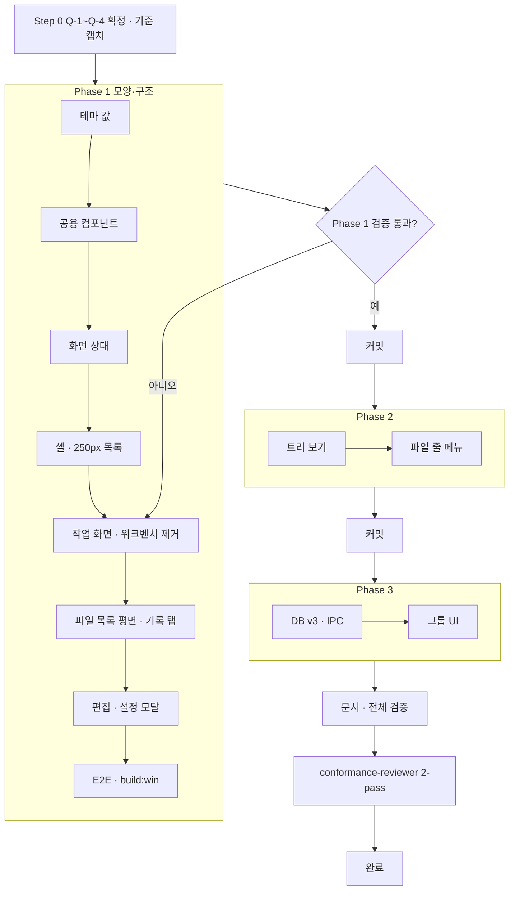

# Plan: 화면 모양과 구조를 1세대 구현(rcloud)과 같게 되돌리기
- Intent: [INT-008](intent.md) | Tier: 3 | 작성일: 2026-11-17
- Intent updated_at: 2026-11-17T15:33:49+09:00
- Spec: [spec.md](spec.md)

## 1. Tier 산정
- **Tier 3 (Strict)**. 근거:
  - 전역 UI 변경: 테마 토큰 값 변경으로 CSS 51개 파일에 영향이 있고, `src/pages/` 47개 화면 중 셸·작업 화면·설정·편집의 구조를 바꾼다.
  - 화면 상태 계약(`src/stores/ui-store.ts:13`, `:15`)과 E2E 10개 spec의 선택자를 바꾼다.
  - Phase 3에서 DB 스키마 v3 마이그레이션(`src/main/store/db-schema.ts:115`)과 IPC 계약(`src/shared/ipc-contract.ts:65`)을 추가한다.
- 하드 게이트 후보: 해당 없음. `[배포·계약 자산 경로]`(src/prompts·agents·skills·mcp·config·scripts) 변경은 없다.

## 2. 실행 순서 (Steps)
원 요구: "D:\dev-Joy\rcloud에서 UI만 똑같이" — rcloud main `7d054be`의 모양·구조로 되돌리고 동작은 유지한다.

| Step | Phase | 내용 | 대상(경로) | 검증 | 롤백 |
| :--- | :--- | :--- | :--- | :--- | :--- |
| 0 | 준비 | §10 Q-1~Q-4 확정. 기준 캡처가 없으면 intent `환경·재현` 명령으로 다시 찍는다(`%TEMP%\rcloud-ui-ref\shots\` 7장). 다크 모드 캡처도 추가한다 | 문서·캡처(저장소 밖) | spec §10 미확인 0건 | - |
| 1 | 1 | 테마 값: rcloud 라이트·다크 값을 기존 토큰 이름에 넣고 3블록 구조를 유지한다. 본문 13px, mono 스택을 바꾼다 | `src/components/themes/default.css:7`·`:29`·`:47`·`:84` | check, 라이트·다크 캡처 비교(AC-1·2) | 파일 되돌림 |
| 2 | 1 | 공용 컴포넌트 모양: Button `small`·padding·radius, Badge 크기, ZBCDot 신규, ZBCToast를 위쪽 가운데 notice로 | `src/components/ZBCButton.tsx:11`, `ZBCBadge.tsx:11`, `ZBCToast`, `ZBC.css` | 단위 테스트, check | 컴포넌트별 되돌림 |
| 3 | 1 | 화면 상태: `typAppView`·`typJobPane`을 `tab`·`editor`·`settingsOpen`으로 바꾸고, 사용처 9개 파일을 옮긴다 | `src/stores/ui-store.ts`, `use-run-flow.ts`, `run-store.ts`, `HomePage`, `JobWorkspace`, `JobSidebar`, `JobEditor`, `SettingsPage`, `TopBar`, `DiscardChangesModal` | typecheck, 단위 테스트 | 커밋 단위 되돌림 |
| 4 | 1 | 셸: 상단 막대(브랜드·알약·설정)와 250px 작업 목록(ZBCDot·선택 막대·하위 문구·`+ 새 작업`) | `AppLayout.tsx`·`.module.css:13`, `TopBar.tsx`, `JobSidebar.tsx` | 캡처 01 비교(AC-3) | 〃 |
| 5 | 1 | 작업 화면: header·toolbar(동기화 단추 문구 = `runBarText`)·안내 줄(`previewNotice`)·실행 배너(`#job-run-panel`)·밑줄 탭·footer. JobStepBar·ComparePlanPanel·JobRunBar 제거, `jobSteps`·`workMainPanel`은 사용처가 없으면 제거하고 테스트 정리 | `JobWorkspace.tsx`, `JobWorkView.tsx`, `JobStepBar.tsx`, `ComparePlanPanel.tsx`, `JobRunBar.tsx`, `JobActivityBar.tsx`, `src/lib/job-steps.ts`, `tests/unit/job-steps.test.ts` | 단위 테스트, 캡처 02·04(AC-4·5·6) | 〃 |
| 6 | 1 | 파일 목록 평면: 칩 필터(Q-1 매핑)·보기 select(Q-2)·rcloud 6열 표·기록 탭 열과 링크 | `CompareView.tsx`, `CompareToolbar.tsx`, `CompareTable.tsx`, `src/lib/compare-view.ts:24`, `HistoryView.tsx` | 단위 테스트(필터), 캡처 03(AC-7) | 〃 |
| 7 | 1 | 모달: JobEditor → 작업 편집 모달, SettingsPage → 설정 모달(섹션 순서 FR-16), 닫기 확인 연결 | `JobEditor.tsx:297`, `SettingsPage.tsx:233`, `HomePage.tsx:156`, `DiscardChangesModal.tsx` | 캡처 05·06(AC-10) | 〃 |
| 8 | 1 | E2E 갱신: `#job-back`·단계 막대·`화면 전환 > 설정`을 새 선택자로 바꾸고, Phase 1 E2E와 build:win을 실행한다 | `tests/e2e/*.spec.ts`, `app-harness.ts` | `pnpm run test:e2e` 콘솔 오류 0, `build:win` | 〃 |
| 9 | 2 | 트리 보기: `itfDiffEntry` → 폴더 트리 빌드·평탄화 순수 함수, `useVirtualRows`로 그리기, 모두 펼치기/접기, 트리/평면 토글 | `src/lib/compare-tree.ts`(신규), `src/pages/CompareTree.tsx`(신규), `src/lib/use-virtual-rows.ts:19` 재사용 | 단위 테스트(중첩·루트·대소문자·1만 행), AC-8 | 신규 파일 삭제 |
| 10 | 2 | 파일 줄 메뉴: 우클릭·메뉴 키로 열리는 `경로 복사` 메뉴(`menu/menuitem`) | `src/pages/FileRowMenu.tsx`(신규), CompareTable·CompareTree | E2E(AC-9) | 〃 |
| 11 | 3 | DB v3: `groups` 테이블과 작업 그룹 연결(Q-3), store·zod(`zJobStoredDraft` groupId default null)·IPC `groups:*`·preload | `src/main/store/db-schema.ts:115`, `job-store.ts`, `group-store.ts`(신규), `src/shared/schemas/job.ts:129`, `src/shared/ipc-contract.ts`, `src/preload/index.ts` | 단위(마이그레이션 v2→v3, 백업, 높은 버전 거부), AC-12 | 마이그레이션 테스트로 막음. 배포 전이라 v3 제거 가능 |
| 12 | 3 | 그룹 UI: 목록 그룹 머리글(접기·이름 바꾸기·지우기 확인), `+ 새 그룹`·GroupNameDialog, 편집 모달 그룹 select | `JobSidebar.tsx`, `GroupNameDialog.tsx`(신규), `JobEditor.tsx` | E2E(AC-11) | 〃 |
| 13 | 마감 | 문서: CHANGELOG·MVP_SPEC §13·README. 전체 검증 | `docs/CHANGELOG.md`, `docs/specs/MVP_SPEC.md`, `README.md` | §4 DoD 전부 | - |

## 3. Intent 태스크 매핑
- intent.md `## 작업`은 `T-01 (착수 시 분해 예정)` 하나다(intent.md에 태스크 미분해). 착수 시 intent에 아래처럼 분해해 기록하기를 제안한다.

| 제안 T | Phase | Step | 내용 |
| :--- | :--- | :--- | :--- |
| T-01 | 1 | 0 | 미해결 질문 확정·기준 캡처(다크 포함) |
| T-02 | 1 | 1~2 | 테마 값·공용 컴포넌트 모양 |
| T-03 | 1 | 3~5 | 화면 상태·셸·작업 화면(워크벤치 제거) |
| T-04 | 1 | 6~8 | 파일 목록 평면·기록 탭·모달·E2E |
| T-05 | 2 | 9~10 | 트리 보기·파일 줄 메뉴 |
| T-06 | 3 | 11~12 | 작업 그룹 DB·UI |
| T-07 | 마감 | 13 | 문서·전체 검증 |
- Phase마다 검증을 통과하면 커밋한다(사용자 메모리 규칙: Phase마다 커밋).

## 4. 검증 계획 (DoD)
- 게이트: 필수(하드) / 근거: ① Tier 3, ③ DB 스키마 마이그레이션 / 방식: 2-pass
- Phase 공통: `pnpm run check`, `pnpm run format:check`
- Phase 1: `pnpm run test:e2e`(Windows PowerShell, 콘솔 오류 0), `pnpm run build:win`. drive-app으로 rcloneGUI 캡처를 rcloud 캡처 01~07과 나란히 비교하고, 다크 모드도 비교한다(AC-1~7·10)
- Phase 2: 트리 순수 함수 단위 테스트(1만 행 포함), E2E 경로 복사(AC-8·9)
- Phase 3: 마이그레이션 단위 테스트(v2 fixture → v3, 백업 파일, 높은 버전 거부), `migration.spec.ts`, 그룹 E2E(AC-11·12)
- 안전 불변: `git diff --stat`에서 `run-service.ts`·`plan-token.ts`·`command-builder.ts` 0줄(AC-13). `pnpm run test:int`는 main 변경이 store·IPC뿐이므로 Phase 3에서 1회 실행한다
- 의존성: `package.json` dependencies·devDependencies 무변경(AC-14)
- 문서: CHANGELOG 한 줄, `docs/works/` 기록

## 5. 리스크 · 파급
- 문제·제약 요약: 정보 밀도·동선·익숙함 문제를 모양·구조 변경으로만 푼다. 안전 규칙 1~6과 화면 뒤 동작은 바꾸지 않는다(intent `## 제약`).
- 범위 밖: 용량 줄, 연쇄 실행, 건너뛴 항목, `이번 동기화에서 빼기`, 보기 4종, 동작 변경.
- 결정: intent D-01~D-03, spec D-04(토큰 이름 유지)·D-05(useVirtualRows 재사용, 폐기: @tanstack)·D-06(경로 복사만)·D-07(워크벤치 문구 재배치).

| 리스크 | 파급 | 대응 |
| :--- | :--- | :--- |
| 워크벤치 제거로 단위·E2E 대량 변경 | `job-steps.test.ts` 592행, E2E 7개 spec | 문구 함수 유지, Step 5·8에서 선택자를 한 번에 정리 |
| 모달 전환 시 저장 안 한 변경 확인 회귀 | 설정·편집 데이터 손실 | DiscardChanges 흐름 E2E 유지(AC-10) |
| 그룹 지정이 jobRev를 올림 | 비교 계획 무효 | Q-3에서 결정. 어느 쪽이든 안전 게이트는 불변 |
| 토큰 값 교체로 대비 저하 | 51개 CSS | 라이트·다크 캡처 비교 |
| 13px 축소로 줄바꿈 변화 | 긴 경로·배지 | 1280px 폭 확인 |
| 마이그레이션 실패 | 사용자 데이터 | 기존 백업·트랜잭션·거부 로직 재사용, v2 fixture 테스트 |
| rcloud 캡처에 실제 경로·remote 이름이 있음 | 안전 규칙 4 | 캡처는 저장소에 넣지 않는다 |

## 6. 실행 흐름

