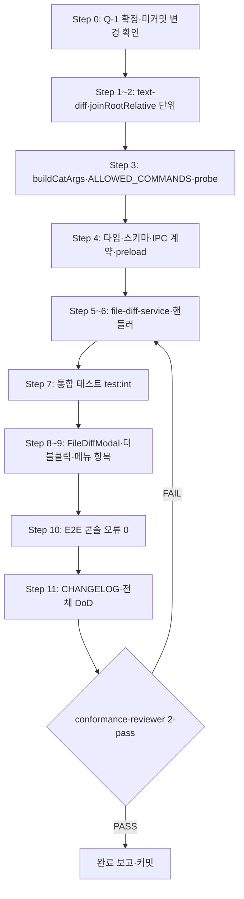

# Plan: 비교 결과의 변경 파일 내용 차이(diff)를 동기화 전에 앱에서 보기
- Intent: [INT-009](intent.md) | Tier: 3 | 작성일: 2026-11-17
- Intent updated_at: 2026-11-17T16:42:44+09:00
- Spec: [spec.md](spec.md)

## 1. Tier 산정
- **Tier 3 (Strict)**. 근거:
  - 안전 경계 변경: rclone 허용 명령 목록(`src/main/rclone/command-builder.ts:101`)에 `cat`을 추가하고 새 빌더를 만든다(AGENTS.md 1.1·1.3).
  - 보안 신호: renderer 요청으로 main이 사용자 파일 내용을 읽어 IPC로 보낸다. 임의 파일 읽기 차단(spec NFR-5)이 핵심 검증 대상이다.
  - 다중 모듈·계약 추가: shared(타입·스키마·diff·경로) + main(빌더·서비스·IPC) + preload + pages(모달·행·메뉴), 새 IPC 채널 `compare:fileDiff`(`src/shared/ipc-contract.ts:95`·`:290`).
  - 화면 변경으로 E2E·`build:win`이 필요하다(AGENTS.md 6장).
- intent 인계 지시의 "Tier 2~3" 중 3을 택했다. 하드 게이트 후보: 해당 없음(`[배포·계약 자산 경로]` src/prompts·agents·skills·mcp·config·scripts 변경 없음).

## 2. 실행 순서 (Steps)
원 요구: "변경된 파일을 diff해 볼 수 있는 기능이 필요해 … 동기화 전에 비교해보려는데 비교가 어려워." — 동기화 전에 변경 내용을 앱 안에서 읽기 전용으로 본다.

| Step | 내용 | 대상(경로) | 검증 | 롤백 |
| :--- | :--- | :--- | :--- | :--- |
| 0 | 준비: spec §10 Q-1 확정. `src/pages/CompareRow.tsx`·`JobWorkspace.tsx`의 다른 작업 미커밋 변경이 정리됐는지 확인(spec R-5). 재현: 아무 작업에서 비교 → '변경' 행 더블클릭(현재 동작 없음) | 문서 | spec §10 미확인 0건, `git status` 확인 | - |
| 1 | 줄 diff 순수 함수: `splitLines`·`diffLines`(Myers, `TEXT_DIFF_MAX_EDITS = 2000`, 공통 앞뒤 잘라내기)·`toSideBySide`(삭제+추가 짝짓기) | `src/shared/text-diff.ts`(신규), `tests/unit/text-diff.test.ts`(신규) | 단위(AC-5, 5만 줄 1초 이내) | 신규 파일 삭제 |
| 2 | 경로 결합: `joinRootRelative(root, rel)` local·UNC·remote(`name:`→`name:rel`), `..`·절대·드라이브·NUL 거부. `itfDiffSide.path`가 상대 경로인지 compare fixture로 확인 | `src/shared/path-utils.ts`(:396 `joinBackupPath` 옆), `tests/unit/path-utils.test.ts` | 단위(AC-6) | 함수 제거 |
| 3 | cat 빌더: `buildCatArgs({path, configPath})`, `ALLOWED_COMMANDS`에 `["cat"]`, `RCLONE_TIMEOUTS.cat = 60_000`. probe로 v1.75.1 cat 동작(텍스트·바이너리·0바이트·없는 파일 종료 코드)을 임시 폴더에서 실측해 `rclone-notes.md`에 기록 | `src/main/rclone/command-builder.ts:101`·`:285` 근처, `src/main/rclone/config.ts:31`, `tests/unit/command-builder.test.ts:588`(스냅샷 갱신), `docs/knowhow/rclone-notes.md` | 단위(AC-7, `BLOCKED_FLAGS` 스냅샷 :548 불변) | 커밋 되돌림 |
| 4 | 타입·스키마·IPC 계약: `itfFileDiffData`·`typFileSideState`, `zCompareFileDiffInput`, `IPC_CHANNELS.compareFileDiff`, API `compare.fileDiff`, preload 노출, renderer 테스트용 `fake-api` 갱신 | `src/shared/types/compare.ts`(또는 `file-diff.ts`), `src/shared/schemas/compare.ts:10`, `src/shared/ipc-contract.ts:95`·`:290`, `src/preload/index.ts:71`, `tests/unit/renderer/fake-api.ts` | typecheck | 〃 |
| 5 | main 서비스: `compareService.get(jobId)` → 항목 찾기(status 검사) → `resolveJobContext`로 src/dst → `joinRootRelative` → size 사전 판정 → `runRclone`(`maxStdoutBytes = 2MB+1`, timeout 60s) → 잘림·NUL(앞 8000바이트)·BOM·인코딩(Q-1) 판정. 한쪽 실패는 `error` 상태(경로 없는 요약) | `src/main/services/file-diff-service.ts`(신규), `src/main/services/compare-service.ts:276`(get 재사용), `src/main/services/job-context.ts:74`(재사용), `tests/unit/file-diff-service.test.ts`(신규) | 단위(AC-4·8·10·12, 가짜 runner로 호출 횟수 확인) | 신규 파일 삭제 |
| 6 | IPC 핸들러 등록: `handle(d, IPC_CHANNELS.compareFileDiff, fn, zCompareFileDiffInput)`, deps 연결 | `src/main/ipc/compare.ts:18`, `src/main/ipc/register.ts:153` | 단위(핸들러 입력 거부), check | 〃 |
| 7 | 통합 테스트: 실제 rclone으로 임시 local 폴더의 텍스트·바이너리·0바이트·상한 초과 파일 | `tests/integration/file-diff.local.test.ts`(신규, `run-harness.ts:116` `makeEnv` 재사용) | `pnpm run test:int`(AC-9) | 신규 파일 삭제 |
| 8 | 모달 화면: `FileDiffModal`(ZBCModal `size="wide"`, 요약 줄, 좌우 2열·줄 번호, 색 토큰, `useVirtualRows`, 한쪽 미리보기·이유 문구·줄바꿈만 다름·상한 초과 문구, 닫은 뒤 응답 버림) | `src/pages/FileDiffModal.tsx`·`.module.css`(신규), `src/components/ZBCModal.tsx:21`·`src/lib/use-virtual-rows.ts:19` 재사용, `src/components/themes/default.css`(색 토큰 필요 시) | 단위(renderer 상태), check | 〃 |
| 9 | 진입 연결: `CompareRow` 더블클릭(`modified`·`onlySource`·`onlyDest`만), `itfFileMenuTarget`에 `status`, `FileRowMenu`에 `원본·대상 내용 비교`(equal·typeConflict는 disabled+title), `CompareView`가 모달 상태 소유 | `src/pages/CompareRow.tsx:79`, `src/pages/FileRowMenu.tsx:16`·`:55`, `src/pages/CompareView.tsx:207`, `src/pages/CompareTree.tsx` | E2E 작성 | 〃 |
| 10 | E2E: 더블클릭·메뉴 진입, 한쪽 미리보기, equal 메뉴 disabled, 콘솔 오류 0 | `tests/e2e/compare-diff.spec.ts`(신규, `tests/e2e/app-harness.ts:214` `expectNoConsoleErrors`, rclone 없으면 skip) | `pnpm run test:e2e`(AC-1~3) | 신규 파일 삭제 |
| 11 | 마감: `docs/CHANGELOG.md` `## [Unreleased]`에 `- 2026-11-17: 비교 결과에서 원본·대상 내용 비교 — …` 한 줄, 필요 시 `docs/specs/MVP_SPEC.md` 반영 표. 전체 검증 | `docs/CHANGELOG.md:3` | §4 DoD 전부(AC-11·13) | - |

## 3. Intent 태스크 매핑
- intent.md `## 작업`은 `T-01 [P2] (착수 시 분해 예정)` 하나다(intent.md에 태스크 미분해). 착수 시 intent에 아래처럼 분해해 기록하기를 제안한다.

| 제안 T | Step | 내용 |
| :--- | :--- | :--- |
| T-01 | 0 | Q-1 확정·미커밋 변경 확인 |
| T-02 | 1~2 | shared 순수 함수(줄 diff·경로 결합) |
| T-03 | 3~7 | cat 빌더·서비스·IPC·통합 테스트 |
| T-04 | 8~10 | 모달·진입 연결·E2E |
| T-05 | 11 | 문서·전체 검증 |
- 사용자 메모리 규칙: 단계(T) 검증을 통과하면 커밋하고 짧게 보고한 뒤 다음 단계로 간다.

## 4. 검증 계획 (DoD)
- 게이트: 필수(하드) / 근거: ① Tier 3, ④ 보안(renderer 요청으로 main이 파일 내용 읽기·rclone 허용 명령 추가) / 방식: 2-pass
- [ ] `pnpm run check`(typecheck + oxlint·eslint + 단위) 통과 — AC-4~8·10·12
- [ ] `pnpm run format:check` 통과
- [ ] `pnpm run test:int` 통과(rclone 없으면 이유 출력 후 skip을 보고) — AC-9
- [ ] `pnpm run test:e2e`(Windows PowerShell) 콘솔 오류 0 — AC-1~3
- [ ] `pnpm run build:win` 성공
- [ ] `git diff`에서 `src/main/services/run-service.ts`·`src/main/services/plan-token.ts`·`package.json` dependencies·`THIRD_PARTY_NOTICES.md` 0줄 — AC-11
- [ ] `BLOCKED_FLAGS` 스냅샷(`tests/unit/command-builder.test.ts:548`) 불변, `ALLOWED_COMMANDS` 스냅샷(:588)은 `cat`만 추가
- [ ] 로그·오류·테스트 이름·fixture에 파일 내용·실제 경로 없음(AGENTS.md 1.4) — 리뷰 확인
- [ ] `docs/CHANGELOG.md` 한 줄, `docs/knowhow/rclone-notes.md` cat 기록, `docs/works/` 작업 내역
- [ ] 브라우저 검증: ego-browser → Aside MCP → 프로젝트 E2E(Playwright) 순 폴백. Electron 앱이므로 프로젝트 E2E가 기본

## 5. 리스크 · 파급
- 파급: 비교 결과 화면(평면·트리 행, 파일 줄 메뉴), IPC 계약, rclone 허용 명령. 비교 판정·전송·계획 토큰·DB에는 파급 없음(spec NFR-1).
- R-1 임의 파일 읽기 → 캐시 항목만 읽음(spec FR-3)·`..` 거부(FR-15)·AC-8. 2-pass 반증 리뷰의 1순위 대상.
- R-2 큰 파일·느린 remote → size 사전 판정·60초 제한·잘림 감지(spec D-04).
- R-3 remote `name:` 결합 함정 → AC-6.
- R-4 CP949 파일 → spec §10 Q-1.
- R-5 다른 작업의 미커밋 변경(`CompareRow.tsx`·`JobWorkspace.tsx`) 충돌 → Step 0 확인.
- R-6 `cat` 허용 → `buildCatArgs` 한 곳만 사용, 리뷰 확인.
- 범위 밖 재확인(intent): 편집·병합·선택 반영, 바이너리·이미지 비교, equal·typeConflict 보기, lsjson 비교 방식 변경은 하지 않는다. 폐기 대안: INT-008 범위 확장(intent D-02), 외부 diff 라이브러리(intent 미해결 질문 답변: 직접 작성), main에서 diff 계산(spec D-03), `cat --count`(spec D-04).

## 6. 실행 흐름

