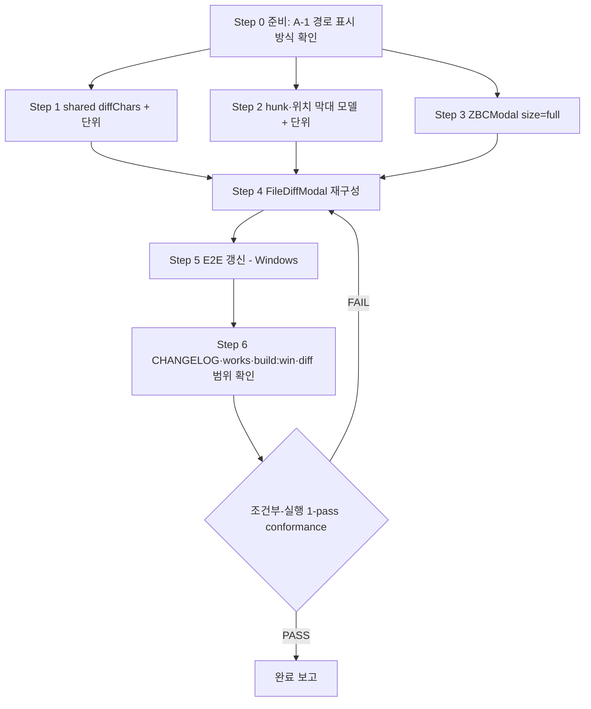

# Plan: 파일 내용 비교 화면을 차이 탐색이 쉬운 좌우 비교 뷰어로 개선
- Intent: [INT-010](intent.md) | Tier: 2 | 작성일: 2026-11-18
- Intent updated_at: 2026-11-18T16:33:52+09:00
- Spec: [spec.md](spec.md)

## 1. Tier 산정
- Tier 2 (Standard)
  - renderer 화면만 바꾼다. 범위는 `src/pages`·`src/lib`·`src/components/ZBCModal`·`src/shared` 순수 함수 추가다.
  - main·preload·IPC·DB·rclone 실행 경로 변경은 0이다. 안전 규칙(AGENTS.md 1.1~1.6) 대상 경로를 건드리지 않는다.
- 상향 조건: 다음 중 하나가 생기면 Tier 3으로 올리고 `code-planner`로 회귀한다.
  - 공용 `ZBCModal` 변경이 다른 페이지 동작에 번진다.
  - A-1에서 IPC 변경이 필요해진다(이 경우 범위를 늘리지 않고 상대 경로만 보이는 것이 기본).
- 하드 게이트 후보 경로(`[배포·계약 자산 경로]`): 해당 없음.
- 환경: Windows 데스크톱 앱(Electron). `test:e2e`·`build:win`은 Windows PowerShell에서 실행한다(AGENTS.md 2장).

## 2. 실행 순서 (Steps)
- Step 0 — 준비
  - 미커밋 변경을 확인한다.
  - `itfFileDiffData`·FileDiffModal props에 원본·대상 루트가 있는지 확인해 A-1 표시 방식을 정한다.
  - 원 요구(첨부 스크린샷 상호작용)를 재확인한다.
  - 검증: 확인 결과 1줄. 롤백: 없음.
- Step 1 — shared 문자 diff
  - `diffChars`(공통 앞·뒤 절단 + LCS, `CHAR_DIFF_MAX_CHARS=2000`)를 만든다. 위치는 `src/shared/text-diff.ts` 또는 `src/shared/char-diff.ts`다.
  - 단위 테스트를 추가한다(같음·한 글자 다름·한쪽 빈 문자열·상한 초과·한글/서로게이트).
  - 검증: `pnpm vitest run tests/unit/text-diff.test.ts`(또는 새 테스트 파일). 롤백: 파일 되돌리기.
- Step 2 — 표시 모델 hunk·위치 막대
  - `file-diff-view.ts`에 `listHunks`·`findNextHunk`·`findPrevHunk`·`toMarkerRatios`를 추가한다.
  - 상한 초과·한쪽 미리보기에서 hunk를 비활성화하는 플래그를 둔다.
  - `tests/unit/file-diff-view.test.ts`에 경계 테스트를 추가한다(spec §7).
  - 검증: 해당 단위 테스트. 롤백: 파일 되돌리기.
- Step 3 — `ZBCModal` `size="full"`
  - 타입 유니온과 `ZBCModal.css` 전용 클래스를 추가한다. 기존 값은 바꾸지 않는다.
  - 검증: `pnpm run check`. 롤백: 2파일 되돌리기.
- Step 4 — FileDiffModal 재구성
  - 툴바(이전·다음 차이, "차이 n곳 중 k"), 패널 머리글 경로, 위치 막대, 빨간 계열 통일·빗금, 줄 선택, 하단 2줄 비교(문자 강조), 키보드(Alt+↑/↓, ↑/↓)를 넣는다.
  - `scrollTop` 직접 설정 또는 `useVirtualRows` 확장(A-2)으로 이동을 구현한다.
  - CSS는 `@layer pages`에 두고 `ROW_HEIGHT` 22px와 일치시킨다.
  - 검증: `pnpm run check`, `pnpm run format:check`. 롤백: 2파일 되돌리기.
- Step 5 — E2E 갱신
  - `tests/e2e/compare-diff.spec.ts`에 다음 확인을 더한다: 첫 hunk 자동 선택, 다음/이전 단추와 Alt+↓/↑, 하단 비교 표시, 위치 막대 표시 개수, 콘솔 오류 0.
  - 기존 단언(머리글·줄 수 문구·한쪽 미리보기)도 유지한다.
  - 검증: `pnpm run test:e2e`(Windows PowerShell). 롤백: spec 파일 되돌리기.
- Step 6 — 마감
  - `docs/CHANGELOG.md`에 한 줄을 남긴다. `docs/works/` 기록과 `pnpm run build:win`을 마친다.
  - `git diff --stat`으로 `src/main`·`src/preload`·`ipc-contract.ts`·`package.json`이 0줄인지 확인한다.
  - 검증: AC-9·AC-10. 롤백: 커밋 단위 revert.

## 3. Intent 태스크 매핑
- intent.md `## 작업`은 아직 `T-01 (착수 시 분해 예정)`뿐이다. 착수할 때 아래처럼 분해한다(intent.md는 이번에 수정하지 않음).
  - T-01 [P2] 준비(Step 0) — A-1 결정, 태스크 분해
  - T-02 [P2] shared `diffChars` + 단위 테스트(Step 1) → FR-10, AC-5
  - T-03 [P2] 표시 모델 hunk·위치 막대 + 단위 테스트(Step 2) → FR-5·FR-6·FR-11·FR-12, AC-6·AC-7
  - T-04 [P2] `ZBCModal` full + FileDiffModal 재구성(Step 3·4) → FR-1~4·FR-7~9·FR-13, AC-1~5·AC-8
  - T-05 [P2] E2E 갱신·마감(Step 5·6) → AC-9·AC-10
- 인계 지시(intent): Tier 2로 진행한다. `ZBCModal` 크기 추가의 영향 페이지 목록(18개, wide 사용 2개)은 spec §3에 기록했다.

## 4. 검증 계획 (DoD)
- 단위: `tests/unit/text-diff.test.ts`(또는 `char-diff.test.ts`), `tests/unit/file-diff-view.test.ts`의 신규 케이스 통과
- 정적·전체: `pnpm run check`(typecheck + oxlint + eslint + 단위), `pnpm run format:check`
- E2E: `pnpm run test:e2e` 전체 통과, 콘솔 오류 0(Windows GUI 세션)
- 패키징: `pnpm run build:win` 성공(화면 변경 — AGENTS.md 6장)
- 범위 확인: `git diff --stat`에서 main·preload·ipc-contract·package.json 0줄(AC-9)
- 통합(`test:int`): main·파서·빌더 변경이 없어 대상이 아니다. 실행해도 결과는 이전과 같아야 한다.
- 게이트: 조건부-실행 / 근거: 저위험 ① 미충족(변경 파일 >3개·여러 최상위 디렉터리 — src/pages·src/lib·src/shared·src/components·tests) / 방식: 1-pass

## 5. 리스크 · 파급
- R-1 E2E 회귀(`compare-diff.spec.ts:49` 문구 단언) → 문구를 유지하고 role/name 기반 단언으로 갱신한다(Step 5).
- R-2 2MB 파일 성능 → hunk 단위로만 그리고, 문자 diff는 선택 행 1개에만 계산한다(NFR-2).
- R-3 Alt+↑/↓ 기본 동작 충돌 → `preventDefault`를 쓰고 E2E로 확인한다.
- R-4 공용 `ZBCModal` 18개 페이지 → 값만 추가하고 전용 클래스로 한정한다. 기존 E2E로 회귀를 확인한다.
- 제약(intent): 읽기 전용(D-02), 전송·계획 토큰·main 무변경, 의존성 0, renderer Node API 금지
- 범위 밖: 편집·병합·저장·3-way·별도 창·최대화 단추·IPC 변경
- 결정 승계: D-01~D-05(spec §9)
- 기각 접근: 별도 BrowserWindow, F8/Shift+F8, 종류별 색 유지(미해결 질문 답변)

## 6. 실행 흐름

